<div align="center">
  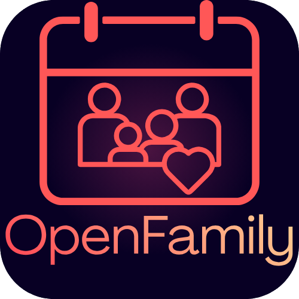
  <h1>OpenFamily</h1>
  <p><strong>Application de gestion familiale open source, auto-hébergeable</strong><br>
  Gardez le contrôle total de vos données : hébergez-la sur votre propre serveur, ou laissez-nous l'héberger pour vous en France.</p>

  🇬🇧 <a href="README.md">English</a> · 🇫🇷 <strong>Français</strong> · 🇨🇳 <a href="README.zh-CN.md">简体中文</a> · 🇯🇵 <a href="README.ja.md">日本語</a>

  [](https://github.com/NexaFlowFrance/OpenFamily/releases/latest)
  [](https://github.com/NexaFlowFrance/OpenFamily/actions/workflows/ci.yml)
  [](https://openfamily.fr/demo/)
  [](licence.md)
  <br><br>
  <a href="https://www.linuxlinks.com/openfamily-self-hosted-family-organiser/"><picture><source media="(prefers-color-scheme: dark)" srcset="docs/badges/linuxlinks-badge-black.png"></picture></a>
</div>

**Transparence du développement :** OpenFamily accepte les contributions assistées par IA. [Consulter les contributions documentées, les revues et les limites des tests](AI_USAGE.md).

---

> 🎬 **[Essayez la démo en ligne](https://openfamily.fr/demo/)** : aucune inscription, rien n'est enregistré.

<div align="center">
  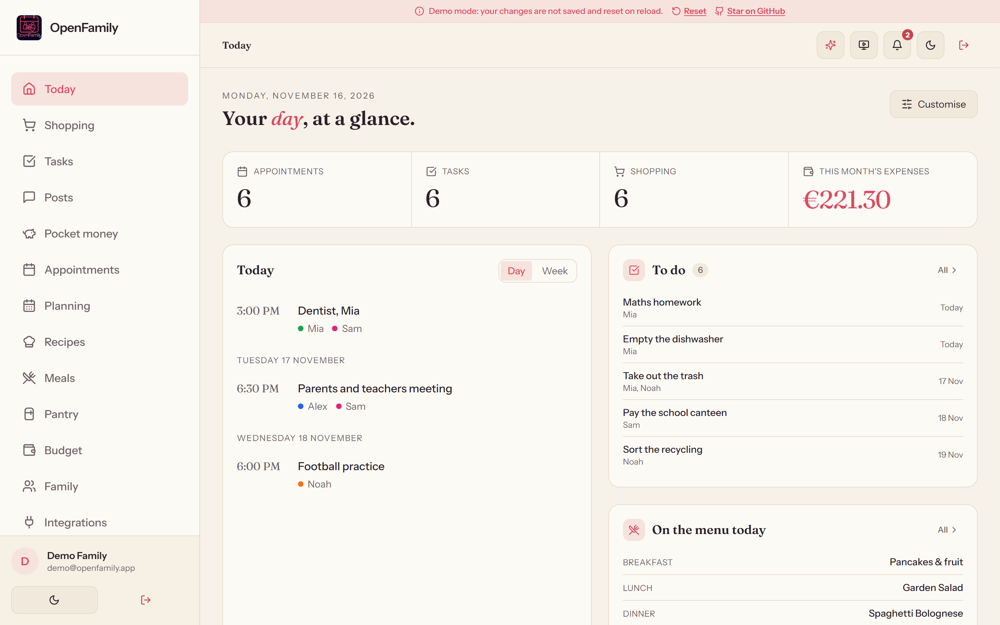
</div>

OpenFamily est une **alternative auto-hébergée à des applications comme Cozi ou FamilyWall** : listes de courses, tâches, agenda partagé, planning de la semaine, recettes, repas, garde-manger et budget du foyer, au même endroit, sur votre propre serveur.

## 🌟 Ce qui le distingue

| | |
|---|---|
| 📱 **Une vraie application Android** | Un [APK](https://github.com/NexaFlowFrance/OpenFamily/releases/latest/download/OpenFamily.apk) qui se connecte à votre propre serveur, tenu à jour avec Obtainium. Sur les autres téléphones, l'application web s'installe sur l'écran d'accueil. |
| 🔌 **Ouvert au reste de la maison** | Une [API documentée](API.md) avec jetons personnels et webhooks, et des intégrations avec Home Assistant, [Gladys Assistant](https://github.com/NexaFlowFrance/gladys-openfamily), Mealie, Tandoor, Grocy et Nextcloud. Votre domotique peut lire la journée de la famille et compléter la liste de courses. |
| 🖼️ **À l'aise sur un mur** | Un mode kiosque pour une tablette dans la cuisine, avec écran de veille, et des pages sans connexion pensées pour un cadre e-paper ou une liseuse. |
| 🤖 **Un assistant qui peut rester à la maison** | Ajoutez des éléments en langage naturel et recevez des idées de menus à partir de vos recettes, avec un modèle local via Ollama ou le fournisseur de votre choix. Facultatif, et éteint tant que vous ne l'avez pas configuré. |
| 🐳 **En service en une commande** | [Un seul conteneur](#-docker-en-une-commande), rien à configurer. Sous Windows, un installateur sans Docker du tout. |
| ☁️ **Ou hébergé pour vous** | [OpenFamily Cloud](https://openfamily.fr/#cloud) fait tourner la même application open source sur des serveurs en France, pour les familles qui préfèrent ne pas en gérer un. Vous pouvez tout exporter et passer sur votre propre serveur quand vous le voulez. |

## 🎯 Fonctionnalités

| | |
|---|---|
| 🛒 **Liste de courses** | Catégorisation, prix, quantités, templates, **mode magasin par rayon** |
| 🧊 **Garde-manger** | Ce qu'il y a à la maison, par emplacement (réfrigérateur, congélateur, placard), avec les dates limites et ce qu'il faut consommer en premier, la **recherche par code-barres** (tapé, scanné avec la caméra ou une douchette) et l'ajout à la liste de courses en un geste |
| ✅ **Tâches** | Tâches récurrentes, assignation familiale, statistiques |
| 📅 **Rendez-vous** | Calendrier mensuel, rappels automatiques, code couleur, **anniversaires** tirés des dates de naissance de la famille, **export iCal (.ics / webcal)** |
| 🗓️ **Planning hebdomadaire** | Horaires de travail et emploi du temps scolaire par membre |
| 🍳 **Recettes** | Bibliothèque familiale, filtres avancés, temps de préparation |
| 🍽️ **Planning repas** | Vue hebdomadaire, export PDF, liaison recettes |
| 💰 **Budget** | Suivi mensuel, **graphiques**, **plafonds par catégorie avec alertes** |
| 👨‍👩‍👧‍👦 **Famille** | Profils membres, informations santé, contacts d'urgence |
| 🔄 **Sync temps réel** | Mise à jour instantanée entre tous les appareils (WebSocket) |
| 🔔 **Notifications** | Rappels de rendez-vous, alertes tâches (Web Push VAPID) + in-app |
| 🖼️ **Écrans muraux et e-paper** | Mode kiosque plein écran pour une tablette, avec un économiseur d'écran (photos ou horloge mobile) pour les écrans allumés toute la journée, et **liens d'affichage** : une page sans connexion qui montre la journée de la famille sur un cadre e-paper (InkyPi), une liseuse ou tout écran qui ne peut pas ouvrir de session |
| 🔌 **API, jetons et webhooks** | Une [API documentée](API.md) pour Home Assistant, Gladys Assistant, n8n ou un script : des jetons personnels en lecture seule ou en écriture, révocables à tout moment, le temps réel par WebSocket, et des webhooks qui préviennent vos outils quand les données de la famille changent |
| 🤖 **Assistant IA** *(facultatif)* | Dites-le en langage naturel (« lasagnes jeudi soir et rappelle à Mia son sac de piscine ») et chaque chose va au bon endroit ; recevez aussi des idées de menus à partir de vos recettes. Fonctionne avec un modèle local (Ollama), toute API compatible OpenAI, Anthropic Claude ou Google Gemini |
| 👥 **Comptes partagés** | Invitations par lien, demandes d'accès, transfert de propriété |
| 🔑 **Connexion unique (SSO)** | Connexion avec votre propre fournisseur OpenID Connect (Authentik, Keycloak, Pocket ID...), serveurs 100 % SSO en option, **déconnexion de tous les appareils** |
| 🛡️ **Rôles & permissions** | Comptes **parent / enfant**, avec un budget en lecture seule pour les enfants |
| 🌍 **Multilingue** | Interface **français / anglais / allemand / portugais / russe / espagnol / catalan / chinois simplifié / japonais** avec détection automatique |
| 📴 **Mode hors ligne** | Consultation des données en cache sans connexion (PWA) |

## 📸 Captures d'écran

| Courses (mode magasin) | Agenda | Budget |
|---|---|---|
| 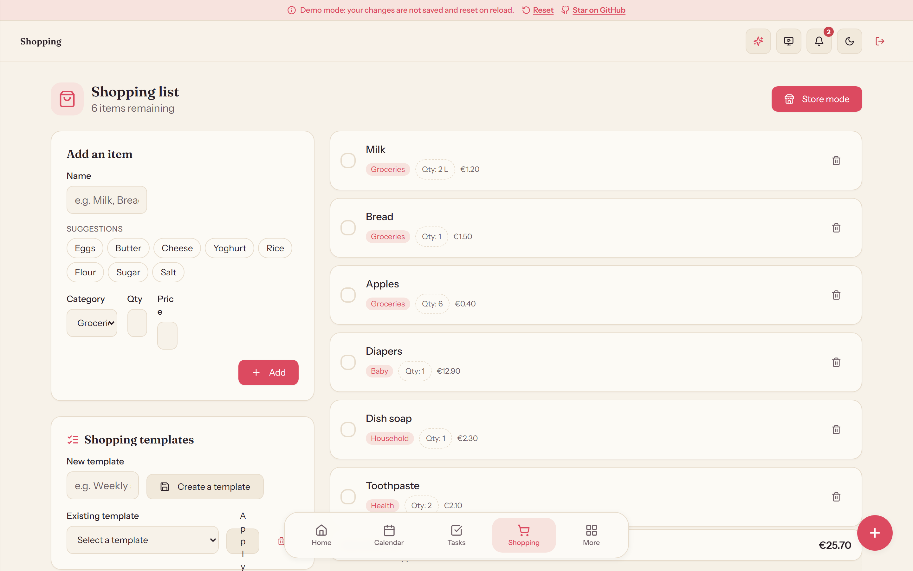 | 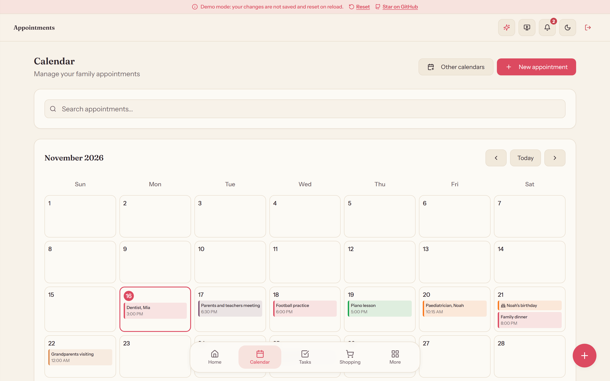 | 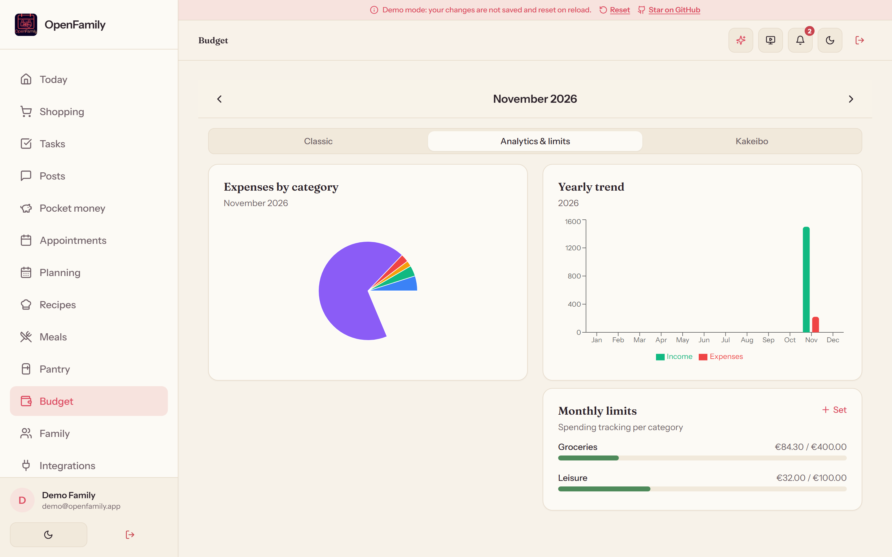 |

| Repas | Famille | Planning de la semaine |
|---|---|---|
| 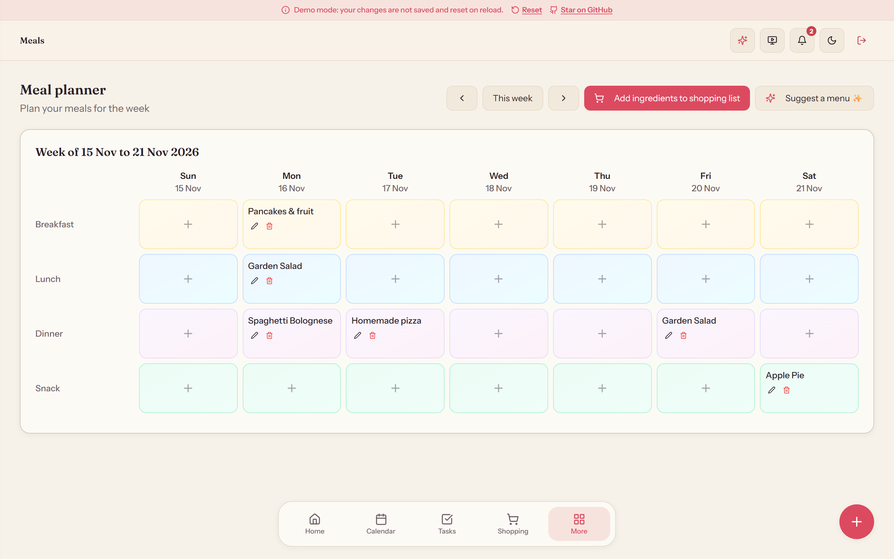 | 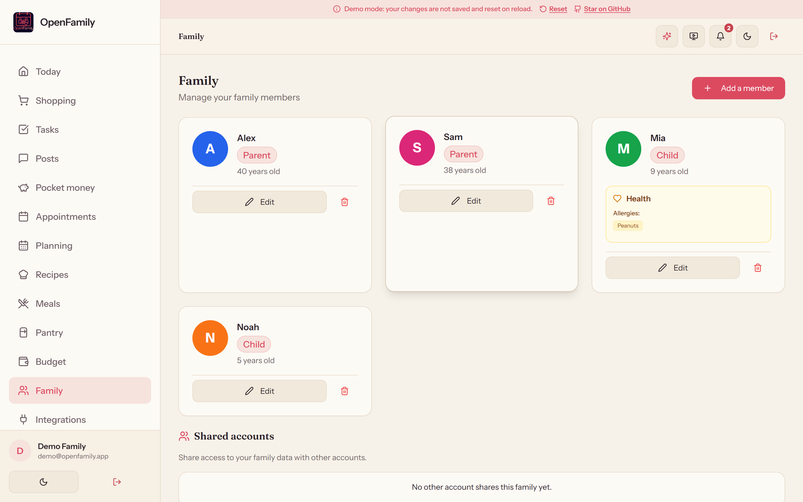 | 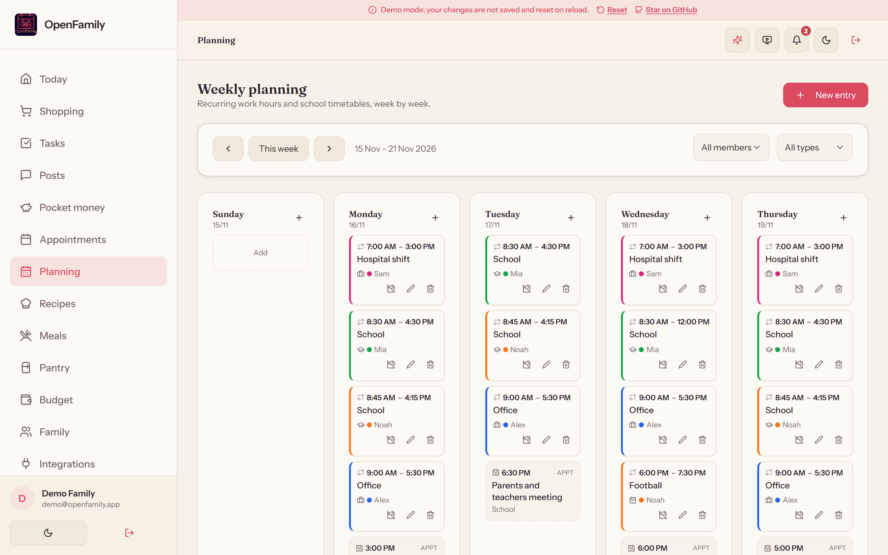 |

En thème sombre :

| Accueil | Agenda | Planning de la semaine |
|---|---|---|
| 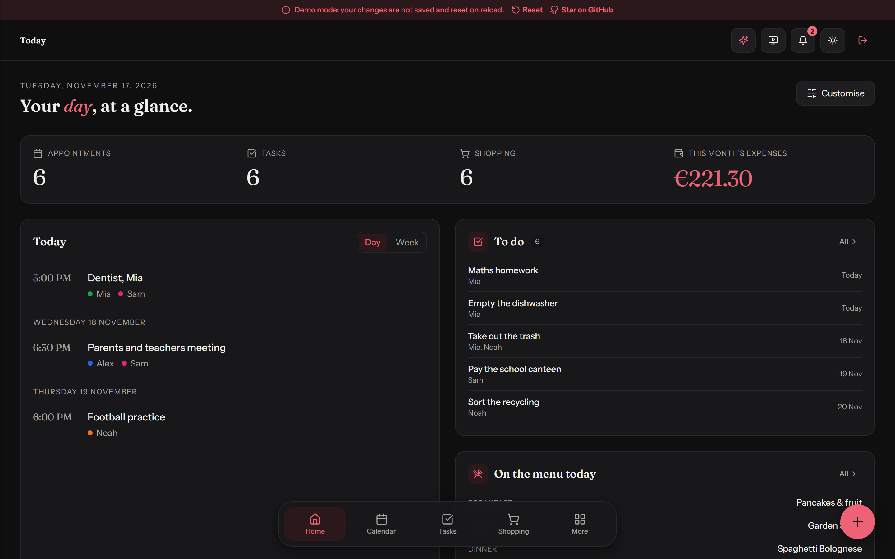 | 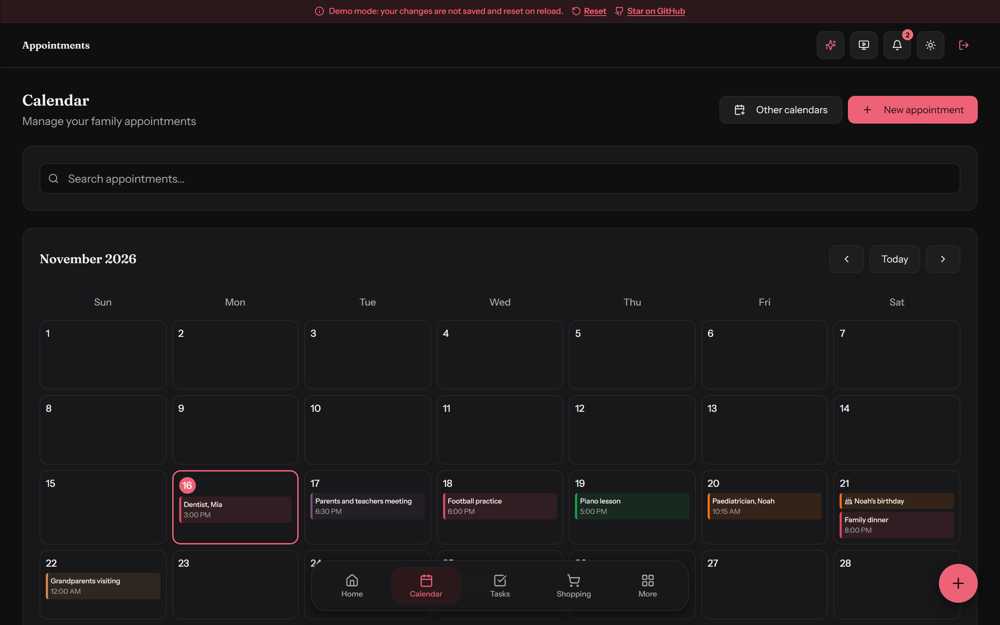 | 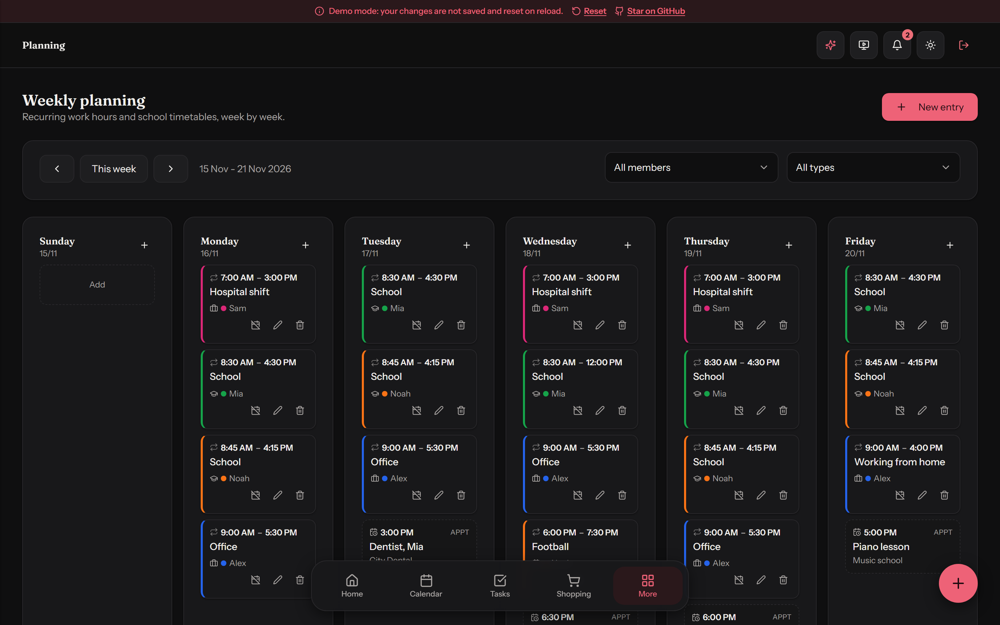 |

Sur un téléphone :

| Accueil | Accueil, thème sombre | Courses | Agenda |
|---|---|---|---|
| 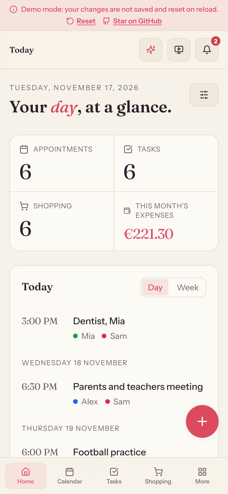 | 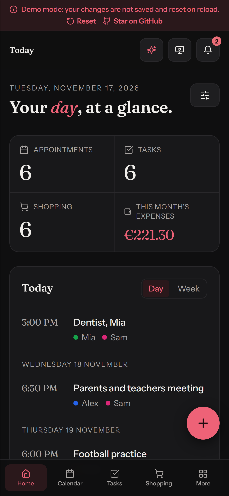 | 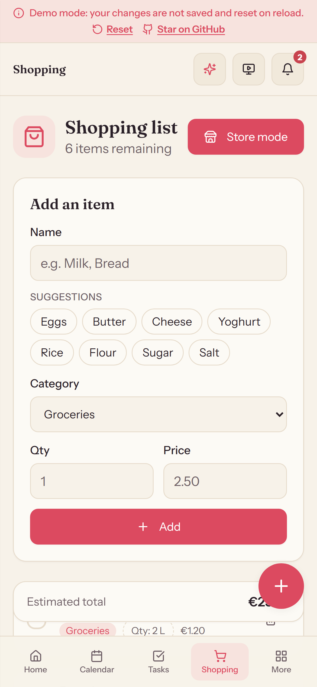 | 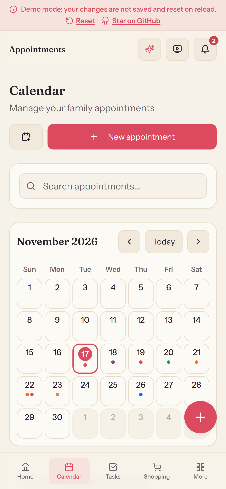 |

## 🔗 Intégrations tierces

| Application | Type | Ce qui est synchronisé |
|---|---|---|
| **[Gladys Assistant](https://github.com/NexaFlowFrance/gladys-openfamily)** | 🏡 Domotique | Le calendrier familial, la liste de courses et les tâches dans [Gladys](https://gladysassistant.com), l'assistant domotique open source français : widgets de tableau de bord, actions et déclencheurs de scène. S'installe depuis le store d'intégrations de Gladys |
| **Mealie** | 🍲 Recettes | Import automatique des recettes (API v1 & v2) |
| **Tandoor** | 🌿 Recettes, planning des repas | Import via l'API Django REST (planning : bouton « Importer depuis Tandoor » du planning des repas) |
| **Home Assistant** | 🏠 Courses | Sync liste de courses via WebSocket |
| **Grocy** | 🥦 Courses & stock | Synchronisation liste de courses et stock |
| **Nextcloud** | ☁️ Calendrier | Import CalDAV avec découverte automatique |

> 🎬 Merci à **[Makernix](https://www.youtube.com/@Makernix)** : c'est lors d'un échange direct avec lui que l'idée des intégrations tierces a émergé.

## 🚀 Démarrage rapide

### 🐳 Docker, en une commande

Un seul conteneur contient l'interface, l'API et la base de données. Il n'y a rien à
configurer : les secrets sont créés au premier démarrage et rangés avec vos données.

```bash
docker run -d --name openfamily --restart unless-stopped \
  -p 3000:3000 -v openfamily:/data \
  ghcr.io/nexaflowfrance/openfamily:latest
```

Ouvrez http://localhost:3000, ou `http://<adresse-du-serveur>:3000` depuis un téléphone, et
créez votre compte. L'image est publiée pour amd64 et arm64 (Raspberry Pi 4 et 5, la plupart
des NAS). Le **[guide serveur](INSTALLATION.fr.md)** couvre le HTTPS, les mises à jour et les
sauvegardes.

Pages de l'image conteneur : [GHCR](https://github.com/NexaFlowFrance/OpenFamily/pkgs/container/openfamily) · [Docker Hub](https://hub.docker.com/r/nexaflow/openfamily).

### 📦 Depuis le catalogue d'applications de votre serveur

Sur ces systèmes, OpenFamily s'installe depuis le catalogue, comme n'importe quelle application. Chaque lien explique comment l'ajouter, pas à pas (en anglais) :

| Système | Comment |
|---|---|
| **Home Assistant** (OS ou Supervised) | [Ajouter le dépôt d'applications](https://my.home-assistant.io/redirect/supervisor_add_addon_repository/?repository_url=https%3A%2F%2Fgithub.com%2FNexaFlowFrance%2Fhome-assistant-apps) · [Guide d'installation](https://github.com/NexaFlowFrance/home-assistant-apps#readme) |
| **Umbrel** | [Ajouter la boutique communautaire](https://github.com/NexaFlowFrance/umbrel-app-store) |
| **CasaOS, ZimaOS** | [Ajouter la boutique d'applications](https://github.com/NexaFlowFrance/casaos-appstore) |
| **Runtipi** | [Ajouter la boutique d'applications](https://github.com/NexaFlowFrance/runtipi-appstore) |
| **Unraid** | [Ouvrir dans Community Applications](https://ca.unraid.net/apps/openfamily-0zg8vge15c4pd6?q=OpenFamily) · [Guide d'installation](https://github.com/NexaFlowFrance/unraid-templates#readme) |
| **TrueNAS** | [OpenFamily dans le catalogue communautaire](https://apps.truenas.com/catalog/openfamily_community/) |
| **Proxmox** | Un [script](INSTALLATION.fr.md#proxmox) qui crée le conteneur |

Les cinq premiers sont nouveaux. Si l'un d'eux ne fonctionne pas chez vous, [dites-le-nous](https://github.com/NexaFlowFrance/OpenFamily/issues) : cela sert à tous ceux qui viendront après.

### 🪟 Windows (.exe), le plus simple

**NexaFlow** fournit un installeur graphique tout-en-un (Node.js et PostgreSQL embarqués, aucun Docker).

<p>
  <a href="https://github.com/NexaFlowFrance/OpenFamily/releases/latest/download/OpenFamily-Setup.exe">
    
  </a>
</p>

### 📱 Application Android (APK)

OpenFamily dispose aussi d'une **application Android native**, un client léger qui se
connecte à **votre propre** serveur (vous saisissez son adresse au premier lancement, comme
les apps Nextcloud ou Home Assistant). Elle n'héberge rien elle-même.

<p>
  <a href="https://github.com/NexaFlowFrance/OpenFamily/releases/latest/download/OpenFamily.apk">
    
  </a>
</p>

Installez l'APK, autorisez les sources inconnues si demandé, ouvrez l'app et saisissez
l'adresse de votre serveur (ex. `http://192.168.1.10:3000`, ou votre adresse HTTPS / Tailscale).

> 🔄 **Mises à jour automatiques :** ajoutez le dépôt à
> **[Obtainium](https://github.com/ImranR98/Obtainium)** pour recevoir les mises à jour
> directement depuis les Releases GitHub, sans store.

### 🧩 Docker Compose, chaque partie dans son conteneur

La même application en trois conteneurs (PostgreSQL, l'API, le serveur web), pour un serveur où vous les voulez séparés ou pour construire depuis les sources. Le **[guide serveur pas à pas](INSTALLATION.fr.md)** détaille tout : secrets à définir, HTTPS avec un domaine ou Tailscale, mises à jour et sauvegardes.

```bash
cp .env.example .env   # éditez vos paramètres
docker-compose up -d --build
```

- Frontend : http://localhost:3000 · Backend : http://localhost:3001

**Vous préférez des images prêtes à l'emploi ?** Chaque version est publiée pour amd64 et arm64. Créez un `docker-compose.override.yml` à côté de `docker-compose.yml` :

```yaml
services:
  server:
    image: ghcr.io/nexaflowfrance/openfamily-server:2.2.0
  client:
    image: ghcr.io/nexaflowfrance/openfamily-client:2.2.0
```

puis lancez `docker compose pull server client && docker compose up -d`, sans `--build`. Les noms d'image prennent bien le suffixe `-server` / `-client`. Les réglages comme `REGISTRATION_ENABLED` sont lus par le serveur au démarrage : les images publiées n'ont pas besoin d'être reconstruites.

### 🛠️ Installation manuelle

```bash
npm run install:all
psql -U postgres -c "CREATE DATABASE openfamily;"
cp .env.example .env
npm run dev
```

## 🛠️ Technologies

**Frontend** : React 19 · TypeScript · Vite 7 · TailwindCSS · Radix UI · i18next · PWA
**Backend** : Node 26 · Express · PostgreSQL 16 · WebSocket · Web Push (VAPID) · JWT + bcrypt
**DevOps** : une image tout-en-un, ou Docker Compose · GitHub Actions (CI + publication ghcr.io)

## 🔐 Sécurité

JWT (7 j, refresh auto) · bcrypt (cost 12) · helmet · rate limiting · CORS strict · validation serveur · connexion unique OpenID Connect en option (PKCE, jetons signés) · sessions révocables par compte.

## 💛 Soutenir le projet

OpenFamily est gratuit, open source (AGPL-3.0) et auto-hébergé : sans publicité, sans
pistage, sans version payante. Il est développé et maintenu sur du temps personnel. Si
l'application aide votre famille, vous pouvez soutenir son développement :

<p>
  <a href="https://github.com/sponsors/NexaFlowFrance">
    
  </a>
  <a href="https://ko-fi.com/nexaflowfrance">
    
  </a>
</p>

Mettre une étoile au dépôt aide tout autant : c'est ainsi que d'autres familles découvrent le projet.

## 🤝 Contribution

Une bonne part d'OpenFamily vient des personnes qui l'utilisent : des langues, des intégrations, des idées devenues des fonctions.

- **Une idée ou une question ?** Lancez une [discussion](https://github.com/NexaFlowFrance/OpenFamily/discussions).
- **Quelque chose ne marche pas ?** Ouvrez une [issue](https://github.com/NexaFlowFrance/OpenFamily/issues/new/choose).
- **Votre langue manque ou est imparfaite ?** [TRANSLATING.md](TRANSLATING.md) (en anglais) : une traduction peut arriver texte par texte, l'application affiche le reste en anglais.
- **Envie d'écrire du code ?** [CONTRIBUTING.md](CONTRIBUTING.md) (en anglais) explique comment lancer le projet et ce qu'attend une pull request.

## 📄 Licence

GNU Affero General Public License v3.0 (AGPL-3.0-only), voir [licence.md](licence.md).

## 🙏 Crédits

Développé et maintenu par [NexaFlow France](https://nexaflow.fr).
