<div align="center">
  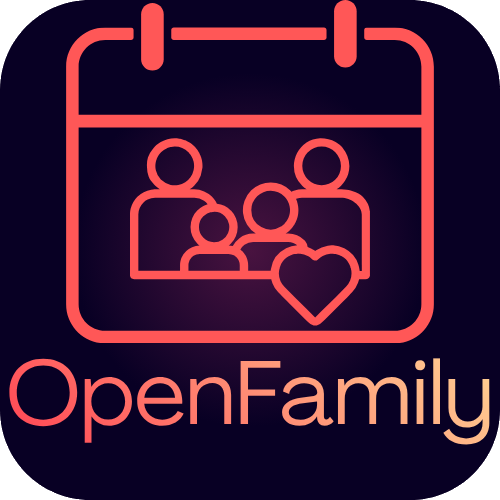
  <h1>OpenFamily</h1>
  <p><strong>オープンソースでセルフホストできる家族向けオーガナイザー</strong><br>
  家族のデータを完全に自分で管理できます。自分のサーバーで動かすか、フランスの私たちのサーバーにホスティングを任せるか選べます。</p>

  🇬🇧 <a href="README.md">English</a> · 🇫🇷 <a href="README.fr.md">Français</a> · 🇨🇳 <a href="README.zh-CN.md">简体中文</a> · 🇯🇵 <strong>日本語</strong>

  [](https://github.com/NexaFlowFrance/OpenFamily/releases/latest)
  [](https://github.com/NexaFlowFrance/OpenFamily/actions/workflows/ci.yml)
  [](https://openfamily.fr/demo/)
  [](https://github.com/NexaFlowFrance/OpenFamily/pkgs/container/openfamily)
  [](licence.md)
  [](https://github.com/NexaFlowFrance/OpenFamily)
  <br><br>
  <a href="https://www.linuxlinks.com/openfamily-self-hosted-family-organiser/"><picture><source media="(prefers-color-scheme: dark)" srcset="docs/badges/linuxlinks-badge-black.png"></picture></a>
</div>

**開発の透明性:** OpenFamily は AI を活用した貢献を受け入れています。[記録された貢献、レビュー記録、テストの限界について読む](AI_USAGE.md)。

---

<div align="center">

### 🎬 [ライブデモを試す](https://openfamily.fr/demo/)

*登録不要、ブラウザの中だけで動き、何も保存されません。*

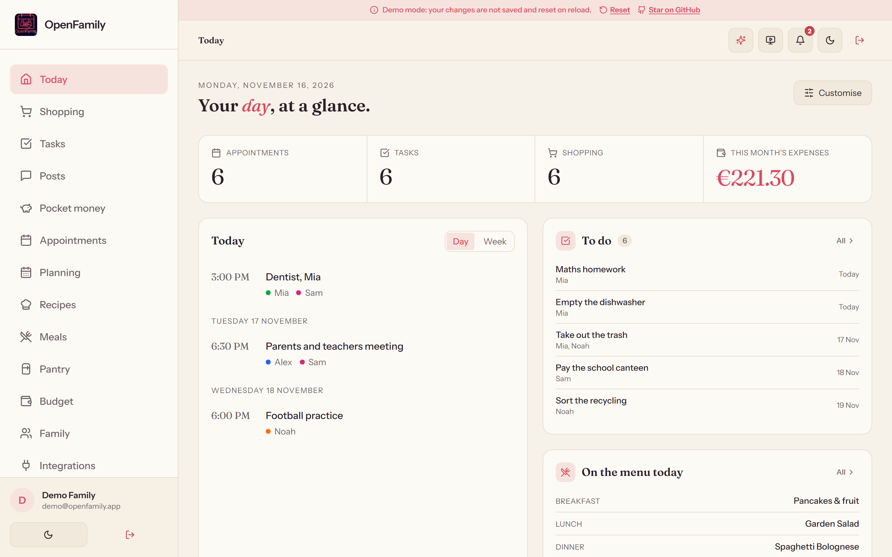

</div>

OpenFamily は **Cozi や FamilyWall のようなアプリのセルフホスト版の代替**です。買い物リスト、
タスク、共有カレンダー、週間予定、レシピ、献立、パントリー、家計簿が
ひとつにまとまり、自分のサーバーで動きます。

## 🌟 特長

| | |
|---|---|
| 📱 **本物の Android アプリ** | 自分のサーバーに接続する [APK](https://github.com/NexaFlowFrance/OpenFamily/releases/latest/download/OpenFamily.apk)。Obtainium で最新の状態に保てます。その他のスマホでは Web アプリをホーム画面にインストールできます。 |
| 🔌 **家の中の他の仕組みとつながる** | 個人トークンと Webhook を備えた[ドキュメント付き API](API.md)があり、Home Assistant、[Gladys Assistant](https://github.com/NexaFlowFrance/gladys-openfamily)、Mealie、Tandoor、Grocy、Nextcloud と連携できます。ホームオートメーションが家族の1日を読み取り、買い物リストへ追加できます。 |
| 🖼️ **壁にかける使い方** | キッチンのタブレット向けのキオスクモード（スクリーンセーバー付き）と、電子ペーパーフレームや電子書籍リーダー向けのログイン不要ページ。 |
| 🤖 **家の中に置けるアシスタント** | ふだんの言葉で追加でき、自分のレシピから献立の提案が受けられます。Ollama 経由のローカルモデルでも、好きなプロバイダーでも。任意機能で、設定するまでオフです。 |
| 🐳 **コマンド1つで起動** | [コンテナ1つ](#-dockerコマンド1つで)、設定不要。Windows では Docker 自体が不要なインストーラーもあります。 |
| ☁️ **ホスティングを任せることも** | [OpenFamily Cloud](https://openfamily.fr/#cloud) は同じオープンソースのアプリをフランスのサーバーで動かします。サーバー運用をしたくない家族向けです。いつでも全部書き出して自分のサーバーへ移せます。 |

## ✨ 機能

| | |
|---|---|
| 🛒 **買い物リスト** | カテゴリ、価格、数量、テンプレート、**売り場を回る順の店内モード** |
| 🧊 **パントリー** | 家にあるものを場所別（冷蔵庫、冷凍庫、食器棚）に、消費期限と「先に食べるもの」の表示、**バーコード検索**（入力、カメラやハンディスキャナーでの読み取り）、買い物リストへワンタップ追加 |
| ✅ **タスク** | 繰り返しタスク、家族への割り当て、統計 |
| 📅 **予定** | 月間カレンダー、自動リマインダー、色分け、家族の生年月日から取り込む**誕生日**、**iCal 書き出し（.ics / webcal）** |
| 🗓️ **週間予定** | 家族一人ひとりの仕事の時間と学校の時間割 |
| 🍳 **レシピ** | 家族のライブラリ、詳細な絞り込み、下ごしらえ・調理時間 |
| 🍽️ **献立** | 週間表示、PDF 書き出し、レシピとの連携 |
| 💰 **予算** | 月別の記録、**グラフ**、**カテゴリ別の上限とアラート**、定期的な引き落とし |
| 👨‍👩‍👧‍👦 **家族** | メンバーのプロフィール、健康情報、緊急連絡先 |
| 🔄 **リアルタイム同期** | 全デバイスへ即時反映（WebSocket） |
| 🔔 **通知** | 予定のリマインダー、タスクのアラート（Web Push VAPID）とアプリ内通知 |
| 🖼️ **壁掛け・電子ペーパー表示** | タブレット向け全画面キオスク（つけっぱなしの画面向けに写真や動く時計のスクリーンセーバー）、**表示リンク**: 電子ペーパーフレーム（InkyPi）や電子書籍リーダー、ログインできない画面向けの、ログイン不要の「家族の1日」ページ |
| 🔌 **API、トークン、Webhook** | Home Assistant、Gladys Assistant、n8n、スクリプト向けの[ドキュメント付き API](API.md): 個人トークン（読み取り専用／読み書き、いつでも失効可）、WebSocket によるリアルタイム更新、家族のデータが変わったときに自分のツールを呼ぶ Webhook |
| 🤖 **AI アシスタント** *(任意)* | ふだんの言葉で言うだけ（「木曜の夜はラザニア、ミアに水泳バッグのリマインド」）で適切な場所に入り、自分のレシピから献立の提案が受けられます。ローカルモデル（Ollama）、OpenAI 互換 API、Anthropic Claude、Google Gemini に対応 |
| 👥 **共有アカウント** | リンクで招待、**アクセスリクエスト**、**所有権の移譲** |
| 🔑 **シングルサインオン** | 自分の OpenID Connect プロバイダー（Authentik、Keycloak、Pocket ID など）でログイン。SSO のみのサーバーも可、**全デバイスからログアウト** |
| 🛡️ **役割と権限** | **保護者／子ども**アカウント、子どもの予算は読み取り専用 |
| 🌍 **多言語** | **英語／フランス語／ドイツ語／ポルトガル語／ロシア語／スペイン語／カタルーニャ語／簡体字中国語／日本語**の画面、自動判定つき |
| 📴 **オフラインモード** | 接続なしでキャッシュ済みデータを閲覧（PWA） |

## 📸 スクリーンショット

| 買い物（店内モード） | カレンダー | 予算 |
|---|---|---|
| 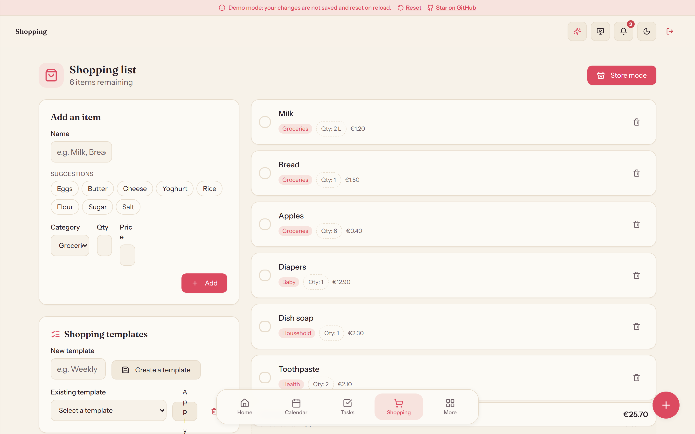 | 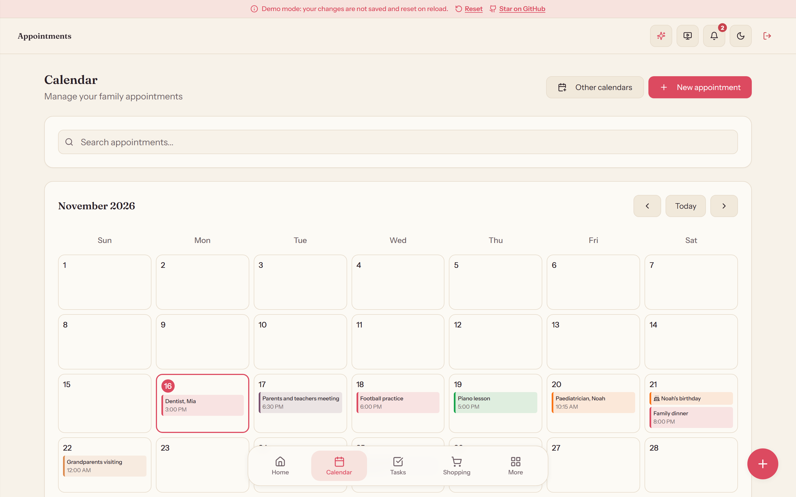 | 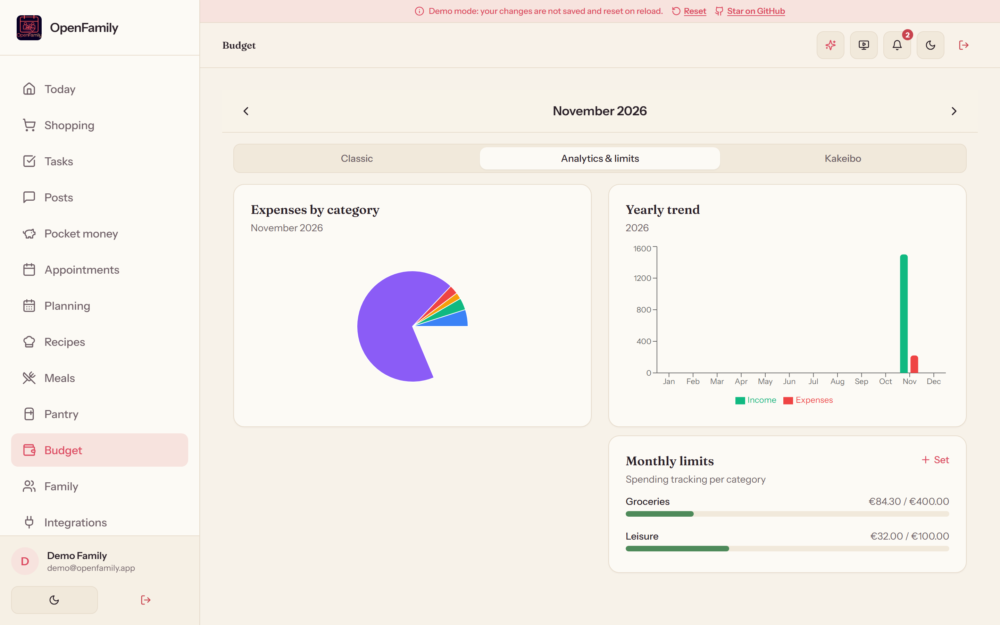 |

| 献立 | 家族 | 週間予定 |
|---|---|---|
| 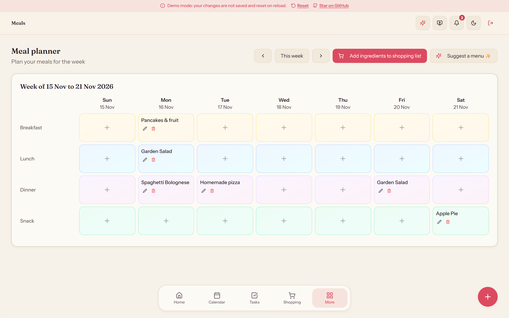 | 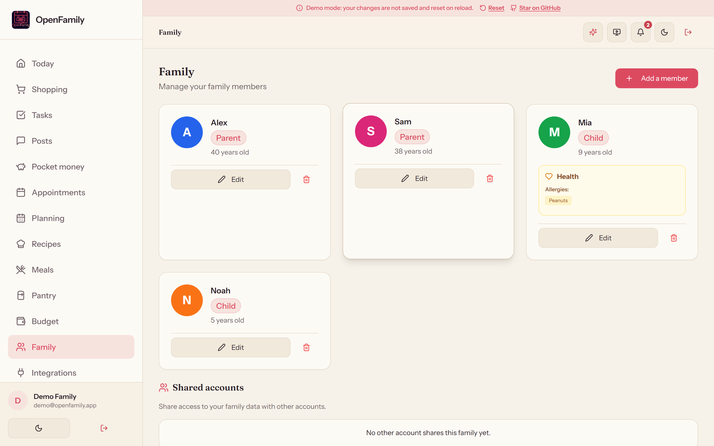 | 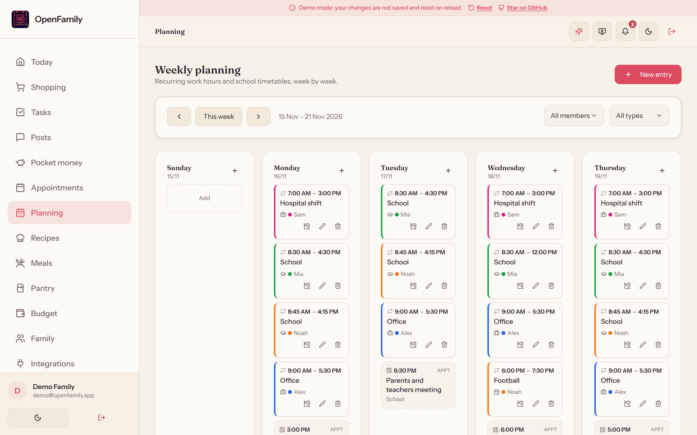 |

ダークテーマ:

| ホーム | カレンダー | 週間予定 |
|---|---|---|
| 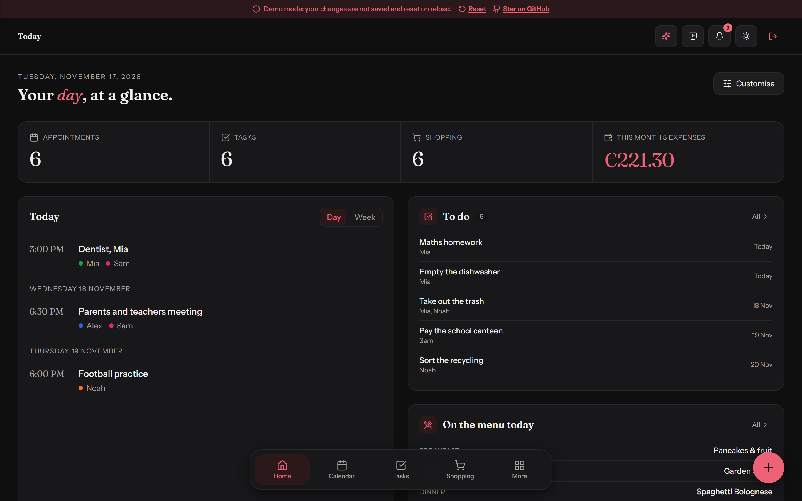 | 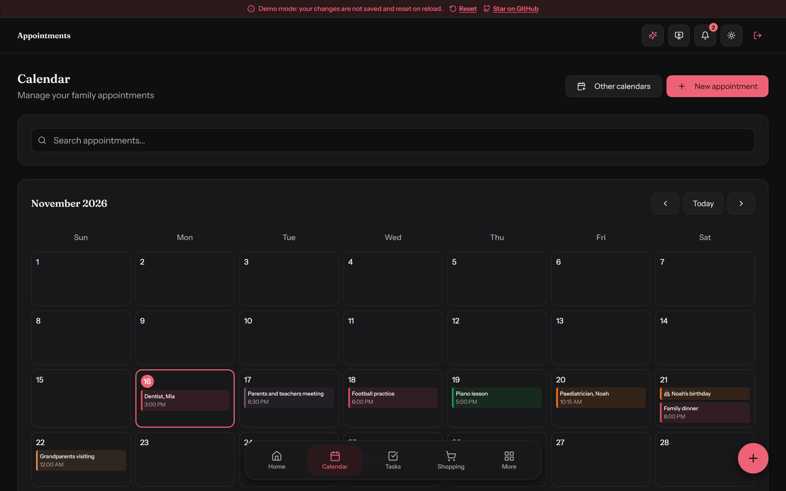 | 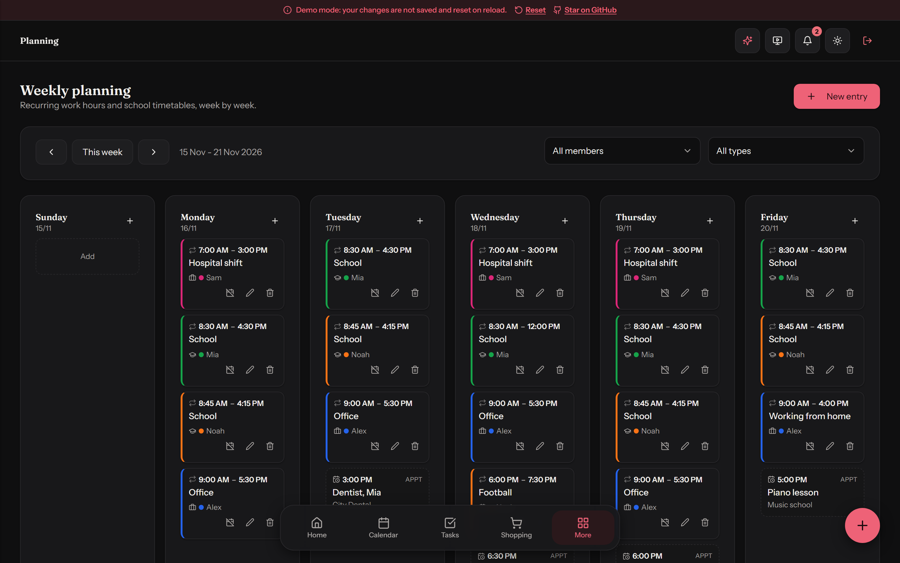 |

スマホでは:

| ホーム | ホーム、ダークテーマ | 買い物 | カレンダー |
|---|---|---|---|
| 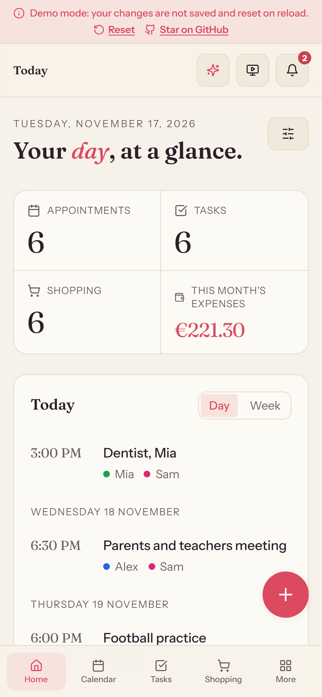 | 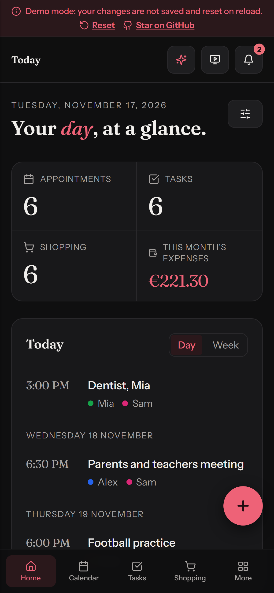 | 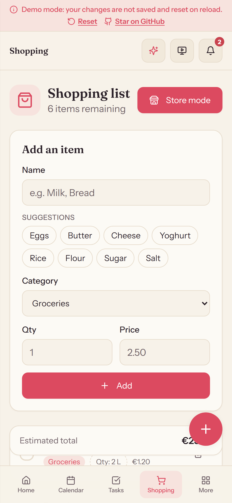 | 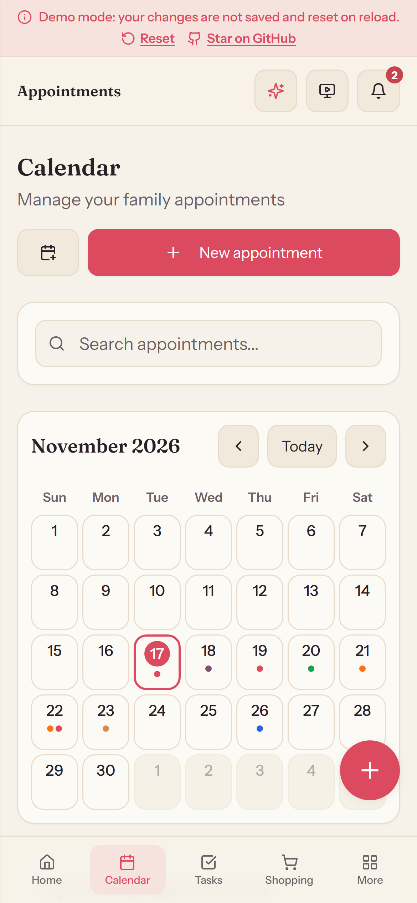 |

## 🔗 外部連携

設定ファイルを編集せずに、連携ページから OpenFamily をセルフホスト環境の他の部分とつなげられます。

| アプリ | 種別 | 同期されるもの |
|---|---|---|
| **[Gladys Assistant](https://github.com/NexaFlowFrance/gladys-openfamily)** | 🏡 ホームオートメーション | フランス発のオープンソースのホームアシスタント [Gladys](https://gladysassistant.com) で家族のカレンダー、買い物リスト、タスクを表示: ダッシュボードのウィジェット、シーンのアクションとトリガー。Gladys の連携ストアからインストール |
| **Mealie** | 🍲 レシピ | 全レシピの自動取り込み（ページング、API v1・v2） |
| **Tandoor** | 🌿 レシピ、献立 | Django REST API 経由の取り込み（献立: 献立ページの「Tandoor から取り込む」ボタン） |
| **Home Assistant** | 🏠 買い物 | WebSocket 経由の買い物リスト同期（モダンな `todo` エンティティとレガシー形式） |
| **Grocy** | 🥦 買い物と在庫 | 買い物リストと在庫の同期 |
| **Nextcloud** | ☁️ カレンダー | 自動発見と UID 単位の重複排除つき CalDAV 取り込み |

> 🎬 **[Makernix](https://www.youtube.com/@Makernix)** さんに感謝:
> OpenFamily をセルフホストの家族向けエコシステム（Mealie、Grocy、Home Assistant、Nextcloud）と
> つなぐアイデアは、彼との直接のやり取りから生まれました。

## 🚀 クイックスタート

### 🐳 Docker、コマンド1つで

コンテナ1つに画面、API、データベースが入っています。設定することは何もありません。
秘密情報は初回起動時に生成され、データと一緒に保持されます。

```bash
docker run -d --name openfamily --restart unless-stopped \
  -p 3000:3000 -v openfamily:/data \
  ghcr.io/nexaflowfrance/openfamily:latest
```

http://localhost:3000 を開くか、スマホから `http://<サーバーのアドレス>:3000` を開いて、
アカウントを作成してください。イメージは amd64 と arm64（Raspberry Pi 4・5、多くの NAS）向けに公開されています。
HTTPS、更新、バックアップは**[サーバーガイド](INSTALLATION.md)**にあります。

コンテナイメージのページ: [GHCR](https://github.com/NexaFlowFrance/OpenFamily/pkgs/container/openfamily) · [Docker Hub](https://hub.docker.com/r/nexaflow/openfamily)

### 📦 サーバーのアプリカタログから

これらのシステムでは、他のアプリと同じようにカタログから OpenFamily をインストールできます。各リンクに手順が段階ごとに書かれています。

| システム | 方法 |
|---|---|
| **Home Assistant**（OS または Supervised） | [アプリリポジトリを追加](https://my.home-assistant.io/redirect/supervisor_add_addon_repository/?repository_url=https%3A%2F%2Fgithub.com%2FNexaFlowFrance%2Fhome-assistant-apps) · [インストールガイド](https://github.com/NexaFlowFrance/home-assistant-apps#readme) |
| **Umbrel** | [コミュニティアプリストアを追加](https://github.com/NexaFlowFrance/umbrel-app-store) |
| **CasaOS、ZimaOS** | [アプリストアを追加](https://github.com/NexaFlowFrance/casaos-appstore) |
| **Runtipi** | [アプリストアを追加](https://github.com/NexaFlowFrance/runtipi-appstore) |
| **Unraid** | [Community Applications で開く](https://ca.unraid.net/apps/openfamily-0zg8vge15c4pd6?q=OpenFamily) · [インストールガイド](https://github.com/NexaFlowFrance/unraid-templates#readme) |
| **TrueNAS** | [コミュニティカタログの OpenFamily](https://apps.truenas.com/catalog/openfamily_community/) |
| **Proxmox** | コンテナを作成する[スクリプト](INSTALLATION.md#proxmox) |

最初の5つは新しいものです。自分の環境で動かなかったら[教えてください](https://github.com/NexaFlowFrance/OpenFamily/issues)。後に続く全員の助けになります。

### 🪟 Windows インストーラー（.exe）、いちばん簡単な方法

Windows ユーザー向けに、**NexaFlow** がオールインワンのグラフィカルインストーラーを提供しています。Node.js と
PostgreSQL が同梱され、**Docker も設定も不要**です。

<p>
  <a href="https://github.com/NexaFlowFrance/OpenFamily/releases/latest/download/OpenFamily-Setup.exe">
    
  </a>
</p>

`OpenFamily-Setup.exe` を実行して **Start** を押すと、アプリが http://localhost:3000 で開きます。
ウィンドウにはローカルネットワークのアドレスも表示されるので、同じ
Wi-Fi のスマホからも開けます。**Settings** タブでは、安全なリモートアクセスのための Tailscale の設定方法も説明されています。

### 📱 Android アプリ（APK）

OpenFamily にはネイティブの **Android アプリ**もあります。**自分の**
サーバーに接続する薄いクライアントです（初回起動時にアドレスを入力します。Nextcloud や Home Assistant の
アプリと同じ方式）。アプリ自体は何もホストしません。

<p>
  <a href="https://github.com/NexaFlowFrance/OpenFamily/releases/latest/download/OpenFamily.apk">
    
  </a>
</p>

APK をインストールし、求められたら提供元不明のアプリのインストールを許可して、アプリを開いて
サーバーの URL を入力してください（例: `http://192.168.1.10:3000`、または HTTPS / Tailscale のアドレス）。

> 🔄 **自動で最新の状態に:** リポジトリを
> **[Obtainium](https://github.com/ImranR98/Obtainium)** に追加すると、アプリストアなしで
> GitHub Releases から直接アプリの更新を受け取れます。

### 🧩 Docker Compose、部品ごとにコンテナを分ける

同じアプリを3つのコンテナ（PostgreSQL、API、Web サーバー）で動かす形です。分けたい場合や、ソースからビルドしたいサーバー向け。段階ごとの**[サーバーガイド](INSTALLATION.md)**で、設定する秘密情報、ドメインや Tailscale での HTTPS、更新、バックアップを案内します。

```bash
cp .env.example .env   # 設定を編集
docker-compose up -d --build
```

- フロントエンド: http://localhost:3000
- バックエンド API: http://localhost:3001

スタック全体の確認:

```bash
npm run smoke:api
```

**ビルド済みイメージがいい場合:** すべてのリリースが amd64 と arm64 向けに公開されています。`docker-compose.yml` の隣に `docker-compose.override.yml` を作ってください。

```yaml
services:
  server:
    image: ghcr.io/nexaflowfrance/openfamily-server:2.3.0
  client:
    image: ghcr.io/nexaflowfrance/openfamily-client:2.3.0
```

そのうえで `--build` なしで `docker compose pull server client && docker compose up -d` を実行します。イメージ名には `-server` / `-client` の接尾辞が必要です。`REGISTRATION_ENABLED` のような設定はサーバーが起動時に読むため、公開イメージの再ビルドは要りません。

### 🛠️ 手動インストール

```bash
npm run install:all
psql -U postgres -c "CREATE DATABASE openfamily;"
cp .env.example .env
npm run dev
```

- フロントエンド: http://localhost:5173 · バックエンド: http://localhost:3001

## 🆚 なぜ OpenFamily か

|  | OpenFamily | Cozi / FamilyWall |
|---|---|---|
| データは自分のサーバーに | ✅ | ❌ |
| オープンソース（AGPL-3.0） | ✅ | ❌ |
| 広告なし、トラッキングなし | ✅ | ❌ |
| セルフホスト連携（Gladys Assistant、Home Assistant、Mealie、Grocy など） | ✅ | ❌ |
| トークンと Webhook を備えたドキュメント付き API | ✅ | ❌ |
| ローカルモデルで動かせる AI アシスタント | ✅ | ❌ |
| オフライン動作（PWA） | ✅ | ⚠️ |

## 🧰 技術スタック

**フロントエンド**: React 19 · TypeScript · Vite 7 · TailwindCSS · Radix UI · i18next · PWA（サービスワーカー、Web Push、オフライン）
**バックエンド**: Node.js 26 · Express · PostgreSQL 16（自動マイグレーション） · WebSocket · Web Push（VAPID） · JWT + bcrypt 12 · helmet · レート制限
**DevOps**: オールインワンイメージ1つ、または Docker Compose（postgres、server、client/nginx） · GitHub Actions（CI + Docker の ghcr.io への公開 + GitHub Pages デモ）

## 🔐 セキュリティ

JWT 認証（7日、自動更新） · パスワードは **bcrypt（コスト 12）** でハッシュ化 · **helmet** による
セキュアな HTTP ヘッダー · 認証エンドポイントへのレート制限 · 設定可能な厳格な CORS ·
サーバー側の入力検証 · 構造化ログ（機密データなし） · 任意の **OpenID Connect
シングルサインオン**（PKCE、署名付き ID トークン） · アカウント単位でセッションを失効可。

## 🗺️ ロードマップ

計画中の機能と設計判断は [ROADMAP.md](ROADMAP.md) にあります。

## 💛 プロジェクトを応援する

OpenFamily は無料で、オープンソース（AGPL-3.0）で、セルフホスト型です。広告なし、トラッキングなし、有料
プランなし。個人の時間で作られ、維持されています。家族の役に立っているなら、開発を応援できます。

<p>
  <a href="https://github.com/sponsors/NexaFlowFrance">
    
  </a>
  <a href="https://ko-fi.com/nexaflowfrance">
    
  </a>
</p>

リポジトリへのスターも同じくらい助けになります。他の家族がこのプロジェクトを見つけるきっかけになるからです。

## 🤝 貢献する

OpenFamily のかなりの部分は、使う人たちから生まれました。言語、連携、機能になったアイデアなどです。

- **アイデアや質問は？** [ディスカッション](https://github.com/NexaFlowFrance/OpenFamily/discussions)から始めてください。
- **何か動かない？** [Issue](https://github.com/NexaFlowFrance/OpenFamily/issues/new/choose) を開いてください。
- **あなたの言語がない、または不完全？** [TRANSLATING.md](TRANSLATING.md): 翻訳は1文ずつでも届けられます。残りはアプリが英語で表示します。
- **コードを書きたい？** [CONTRIBUTING.md](CONTRIBUTING.md) にプロジェクトの動かし方と PR に必要なことが書かれています。

## 📄 ライセンス

GNU Affero General Public License v3.0（AGPL-3.0-only）。[licence.md](licence.md) を参照してください。

## 🙏 クレジット

[NexaFlow France](https://nexaflow.fr) が作り、維持しています。
