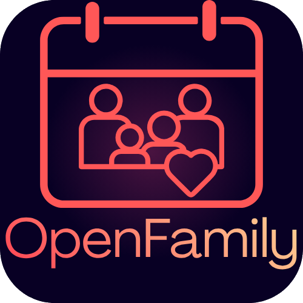
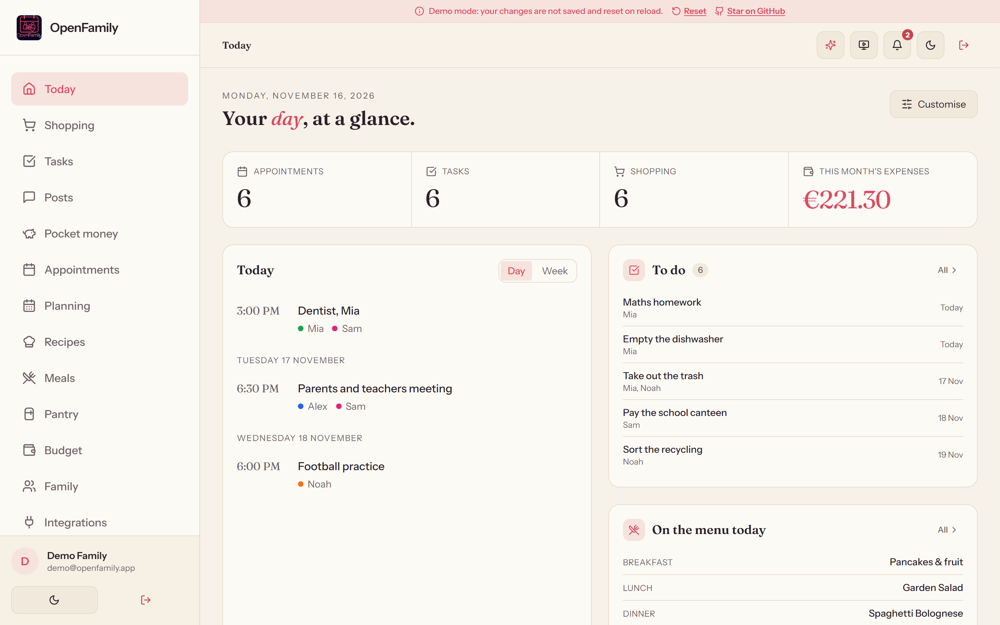
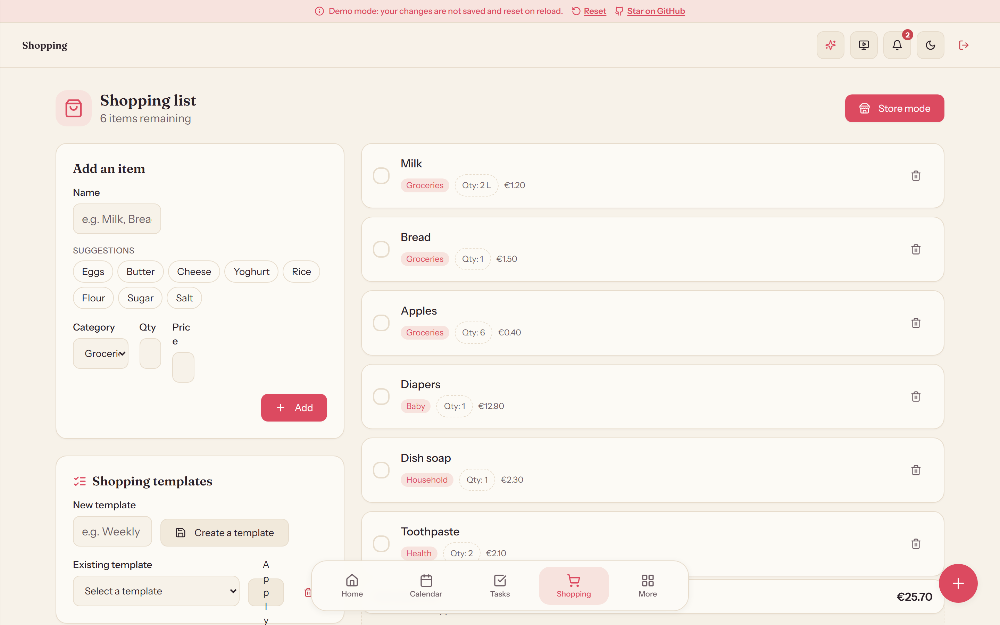
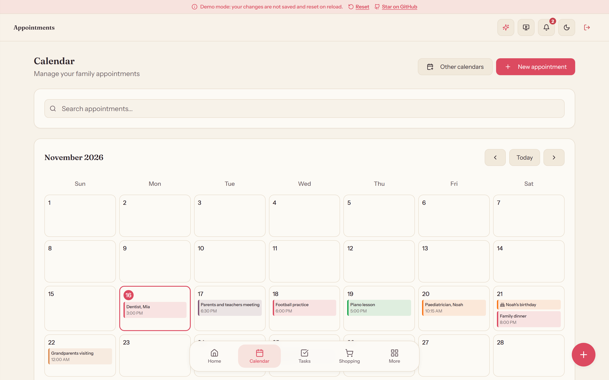
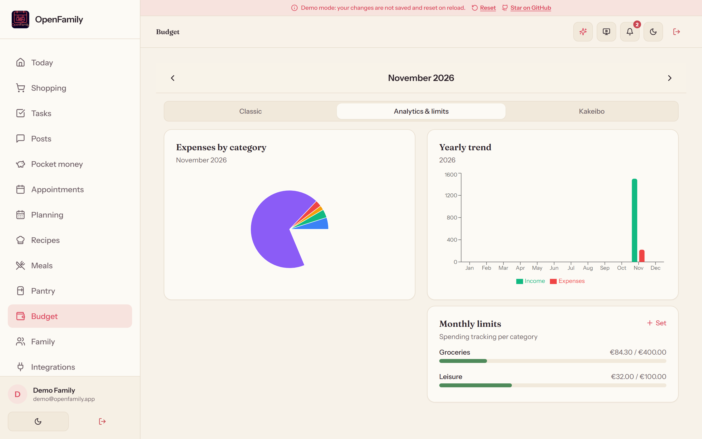
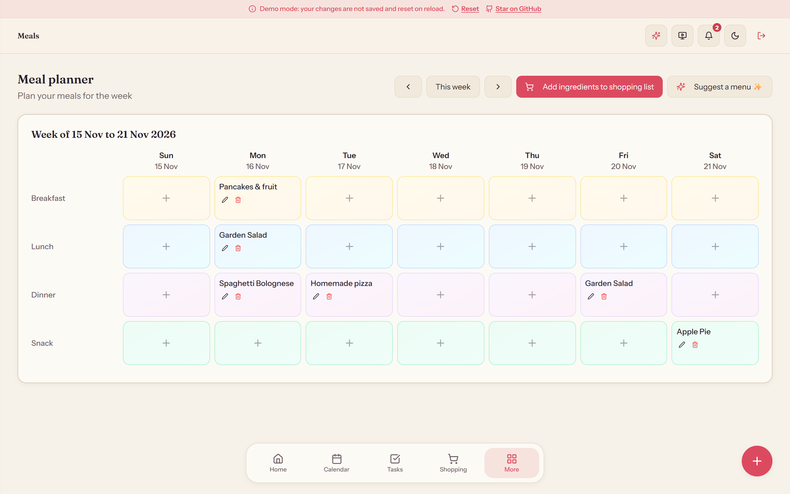
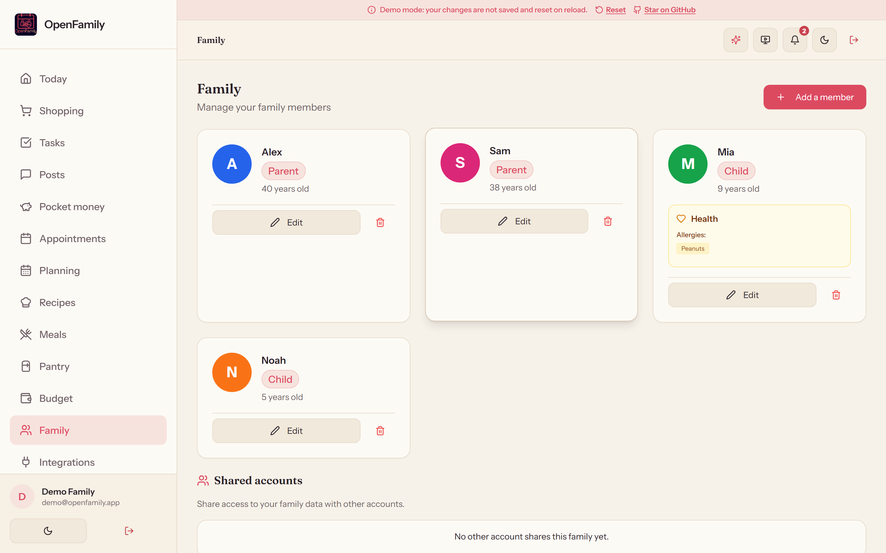
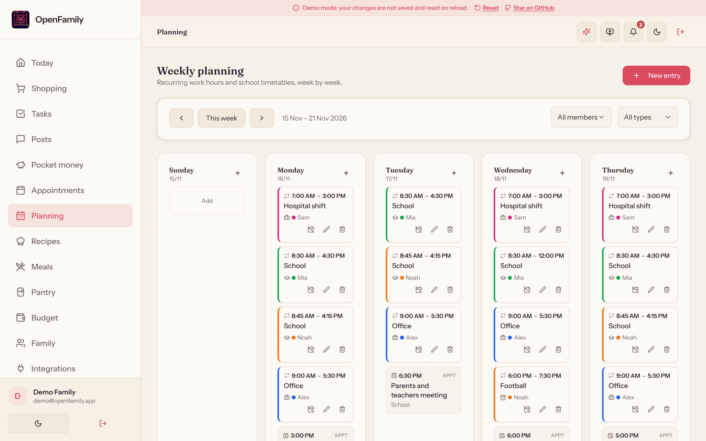

<div align="center">
  
  <h1>OpenFamily</h1>
  <p><strong>The open-source, self-hosted family organizer</strong><br>
  Keep full control of your family's data: run it on your own server, or let us host it for you in France.</p>

  🇬🇧 <strong>English</strong> · 🇫🇷 <a href="README.fr.md">Français</a> · 🇨🇳 <a href="README.zh-CN.md">简体中文</a>

  [](https://github.com/NexaFlowFrance/OpenFamily/releases/latest)
  [](https://github.com/NexaFlowFrance/OpenFamily/actions/workflows/ci.yml)
  [](https://openfamily.fr/demo/)
  [](https://github.com/NexaFlowFrance/OpenFamily/pkgs/container/openfamily)
  [](licence.md)
  [](https://github.com/NexaFlowFrance/OpenFamily)
</div>

---

<div align="center">

### 🎬 [Try the live demo](https://openfamily.fr/demo/)

*No sign-up, runs entirely in your browser, nothing is saved.*



</div>

OpenFamily is a **self-hosted alternative to apps like Cozi or FamilyWall**: shopping lists,
tasks, a shared calendar, weekly planning, recipes, meal planning, a pantry and a household
budget, all in one place, on your own server.

## 🌟 What sets it apart

| | |
|---|---|
| 📱 **A real Android app** | An [APK](https://github.com/NexaFlowFrance/OpenFamily/releases/latest/download/OpenFamily.apk) that connects to your own server, kept up to date with Obtainium. On any other phone, the web app installs to the home screen. |
| 🔌 **Open to the rest of the house** | A [documented API](API.md) with personal tokens and webhooks, and integrations with Home Assistant, [Gladys Assistant](https://github.com/NexaFlowFrance/gladys-openfamily), Mealie, Tandoor, Grocy and Nextcloud. Your home automation can read the family's day and add to the shopping list. |
| 🖼️ **At home on a wall** | A kiosk mode for a tablet in the kitchen, with a screensaver, and login-free pages made for an e-paper frame or an e-reader. |
| 🤖 **An assistant that can stay at home** | Add things in plain language and get menu ideas from your own recipes, with a local model through Ollama or the provider of your choice. Optional, and off until you set it up. |
| 🐳 **Running in one command** | [One container](#-docker-in-one-command), nothing to configure. On Windows, an installer with no Docker at all. |
| ☁️ **Or hosted for you** | [OpenFamily Cloud](https://openfamily.fr/#cloud) runs the same open-source app on servers in France, for families who would rather not run one. You can export everything and move to your own server whenever you want. |

## ✨ Features

| | |
|---|---|
| 🛒 **Shopping list** | Categories, prices, quantities, templates, **aisle-by-aisle store mode** |
| 🧊 **Pantry** | What is at home, by place (fridge, freezer, cupboard), with use-by dates and what to eat first, **barcode lookup** (typed, scanned with the camera or a handheld scanner) and one tap to the shopping list |
| ✅ **Tasks** | Recurring tasks, family assignment, statistics |
| 📅 **Appointments** | Monthly calendar, automatic reminders, color coding, **birthdays** taken from the family's dates of birth, **iCal export (.ics / webcal)** |
| 🗓️ **Weekly planning** | Work hours and school timetables per family member |
| 🍳 **Recipes** | Family library, advanced filters, prep/cook times |
| 🍽️ **Meal planner** | Weekly view, PDF export, linked recipes |
| 💰 **Budget** | Monthly tracking, **charts**, **per-category limits with alerts**, recurring debits |
| 👨‍👩‍👧‍👦 **Family** | Member profiles, health info, emergency contacts |
| 🔄 **Real-time sync** | Instant updates across every device (WebSocket) |
| 🔔 **Notifications** | Appointment reminders, task alerts (Web Push VAPID) + in-app |
| 🖼️ **Wall & e-paper displays** | Full-screen kiosk for a tablet, with a screensaver (photos or a moving clock) for screens left on all day, and **display links**: a login-free page of the family's day for an e-paper frame (InkyPi), an e-reader or any screen that cannot sign in |
| 🔌 **API, tokens & webhooks** | A [documented API](API.md) for Home Assistant, Gladys Assistant, n8n or a script: personal tokens, read-only or read-write and revocable at any time, real-time updates over WebSocket, and webhooks that call your tools when the family's data changes |
| 🤖 **AI assistant** *(optional)* | Say it in plain language ("lasagna on Thursday evening, and remind Mia about her swimming bag") and it lands in the right place, and get menu ideas from your recipes. Works with a local model (Ollama), any OpenAI-compatible API, Anthropic Claude or Google Gemini |
| 👥 **Shared accounts** | Invite by link, **access requests**, **ownership transfer** |
| 🔑 **Single sign-on** | Sign in with your own OpenID Connect provider (Authentik, Keycloak, Pocket ID...), optional SSO-only servers, **sign out of all devices** |
| 🛡️ **Roles & permissions** | **Parent / child** accounts, with a read-only budget for children |
| 🌍 **Multilingual** | **English / French / German / Portuguese / Russian / Spanish / Catalan / Simplified Chinese** interface with automatic detection |
| 📴 **Offline mode** | Browse cached data without a connection (PWA) |

## 📸 Screenshots

| Shopping (store mode) | Calendar | Budget |
|---|---|---|
|  |  |  |

| Meal planner | Family | Weekly planning |
|---|---|---|
|  |  |  |

## 🔗 Third-party integrations

Connect OpenFamily to the rest of your self-hosted setup from the Integrations page, with no config file to edit.

| App | Type | What is synced |
|---|---|---|
| **[Gladys Assistant](https://github.com/NexaFlowFrance/gladys-openfamily)** | 🏡 Home automation | The family calendar, shopping list and tasks in [Gladys](https://gladysassistant.com), the open-source home assistant made in France: dashboard widgets, scene actions and triggers. Installed from the Gladys integration store |
| **Mealie** | 🍲 Recipes | Automatic import of all recipes (pagination, API v1 & v2) |
| **Tandoor** | 🌿 Recipes, meal plan | Import via the Django REST API (meal plan: "Import from Tandoor" button on the meal planning page) |
| **Home Assistant** | 🏠 Shopping | Shopping-list sync over WebSocket (modern `todo` entities + legacy) |
| **Grocy** | 🥦 Shopping & stock | Shopping list and stock synchronization |
| **Nextcloud** | ☁️ Calendar | CalDAV import with auto-discovery and per-UID deduplication |

> 🎬 Thanks to **[Makernix](https://www.youtube.com/@Makernix)**: the idea of connecting
> OpenFamily to the self-hosted family ecosystem (Mealie, Grocy, Home Assistant, Nextcloud)
> emerged from a direct exchange with him.

## 🚀 Quick start

### 🐳 Docker, in one command

One container holds the interface, the API and the database. There is nothing to configure:
the secrets are generated on the first start and kept with your data.

```bash
docker run -d --name openfamily --restart unless-stopped \
  -p 3000:3000 -v openfamily:/data \
  ghcr.io/nexaflowfrance/openfamily:latest
```

Open http://localhost:3000, or `http://<server-address>:3000` from a phone, and create your
account. The image is published for amd64 and arm64 (Raspberry Pi 4 and 5, most NAS). The
**[server guide](INSTALLATION.md)** covers HTTPS, updates and backups.

### 🪟 Windows installer (.exe), the easiest path

For Windows users, **NexaFlow** provides an all-in-one graphical installer: Node.js and
PostgreSQL are bundled: **no Docker, no configuration** required.

<p>
  <a href="https://github.com/NexaFlowFrance/OpenFamily/releases/latest/download/OpenFamily-Setup.exe">
    
  </a>
</p>

Run `OpenFamily-Setup.exe`, click **Start**, and the app opens at http://localhost:3000.
The window also shows your local network address so you can open it from a phone on the same
Wi-Fi, and the **Settings** tab explains how to set up Tailscale for secure remote access.

### 📱 Android app (APK)

OpenFamily also has a native **Android app**, a thin client that connects to **your own**
server (you enter its address on first launch, just like the Nextcloud or Home Assistant
apps). It hosts nothing itself.

<p>
  <a href="https://github.com/NexaFlowFrance/OpenFamily/releases/latest/download/OpenFamily.apk">
    
  </a>
</p>

Install the APK, allow installs from unknown sources when prompted, open the app and enter
your server URL (e.g. `http://192.168.1.10:3000`, or your HTTPS / Tailscale address).

> 🔄 **Stay up to date automatically:** add the repo to
> **[Obtainium](https://github.com/ImranR98/Obtainium)** to receive app updates straight from
> GitHub Releases, with no app store required.

### 🧩 Docker Compose, each part in its own container

The same app as three containers (PostgreSQL, the API, the web server), for a server where you want them apart or want to build from the sources. The step-by-step **[server guide](INSTALLATION.md)** walks through it: secrets to set, HTTPS with a domain or Tailscale, updates and backups.

```bash
cp .env.example .env   # edit your settings
docker-compose up -d --build
```

- Frontend: http://localhost:3000
- Backend API: http://localhost:3001

Verify the stack end-to-end:

```bash
npm run smoke:api
```

**Prefer ready-made images?** Every release is published for amd64 and arm64. Create a `docker-compose.override.yml` next to `docker-compose.yml`:

```yaml
services:
  server:
    image: ghcr.io/nexaflowfrance/openfamily-server:2.2.0
  client:
    image: ghcr.io/nexaflowfrance/openfamily-client:2.2.0
```

then run `docker compose pull server client && docker compose up -d`, without `--build`. The image names need their `-server` / `-client` suffix. Settings such as `REGISTRATION_ENABLED` are read by the server at startup, so the published images need no rebuild.

### 🛠️ Manual install

```bash
npm run install:all
psql -U postgres -c "CREATE DATABASE openfamily;"
cp .env.example .env
npm run dev
```

- Frontend: http://localhost:5173 · Backend: http://localhost:3001

## 🆚 Why OpenFamily?

|  | OpenFamily | Cozi / FamilyWall |
|---|---|---|
| Your data on your server | ✅ | ❌ |
| Open source (AGPL-3.0) | ✅ | ❌ |
| No ads, no tracking | ✅ | ❌ |
| Self-hosted integrations (Gladys Assistant, Home Assistant, Mealie, Grocy…) | ✅ | ❌ |
| A documented API, with tokens and webhooks | ✅ | ❌ |
| An AI assistant that can run on a local model | ✅ | ❌ |
| Works offline (PWA) | ✅ | ⚠️ |

## 🧰 Tech stack

**Frontend**: React 19 · TypeScript · Vite 7 · TailwindCSS · Radix UI · i18next · PWA (service worker, web push, offline)
**Backend**: Node.js 26 · Express · PostgreSQL 16 (auto-migration) · WebSocket · Web Push (VAPID) · JWT + bcrypt 12 · helmet · rate limiting
**DevOps**: one all-in-one image, or Docker Compose (postgres, server, client/nginx) · GitHub Actions (CI + Docker publish to ghcr.io + GitHub Pages demo)

## 🔐 Security

JWT auth (7 days, auto refresh) · passwords hashed with **bcrypt (cost 12)** · secure HTTP
headers via **helmet** · rate limiting on auth endpoints · strict configurable CORS ·
server-side input validation · structured logs (no sensitive data) · optional **OpenID Connect
single sign-on** (PKCE, signed ID tokens) · sessions revocable per account.

## 🗺️ Roadmap

Planned features and design decisions live in [ROADMAP.md](ROADMAP.md).

## 💛 Support the project

OpenFamily is free, open source (AGPL-3.0) and self-hosted: no ads, no tracking, no paid
tier. It is built and maintained on personal time. If it helps your family, you can support
its development:

<p>
  <a href="https://github.com/sponsors/NexaFlowFrance">
    
  </a>
  <a href="https://ko-fi.com/nexaflowfrance">
    
  </a>
</p>

Starring the repository helps just as much: it is how other families find the project.

## 🤝 Contributing

A good part of OpenFamily came from the people who use it: languages, integrations, ideas that became features.

- **An idea or a question?** Start a [discussion](https://github.com/NexaFlowFrance/OpenFamily/discussions).
- **Something does not work?** Open an [issue](https://github.com/NexaFlowFrance/OpenFamily/issues/new/choose).
- **Your language is missing or imperfect?** [TRANSLATING.md](TRANSLATING.md): a translation can arrive one text at a time, the app shows the rest in English.
- **You want to write code?** [CONTRIBUTING.md](CONTRIBUTING.md) says how to run the project and what a pull request needs.

## 📄 License

GNU Affero General Public License v3.0 (AGPL-3.0-only), see [licence.md](licence.md).

## 🙏 Credits

Built and maintained by [NexaFlow France](https://nexaflow.fr).
