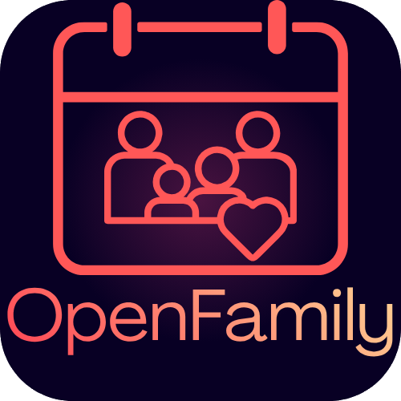
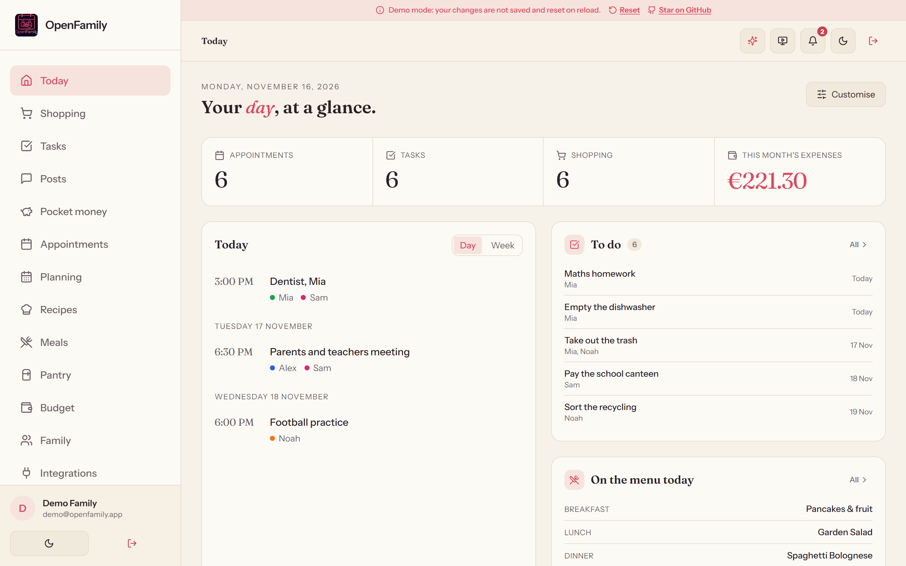
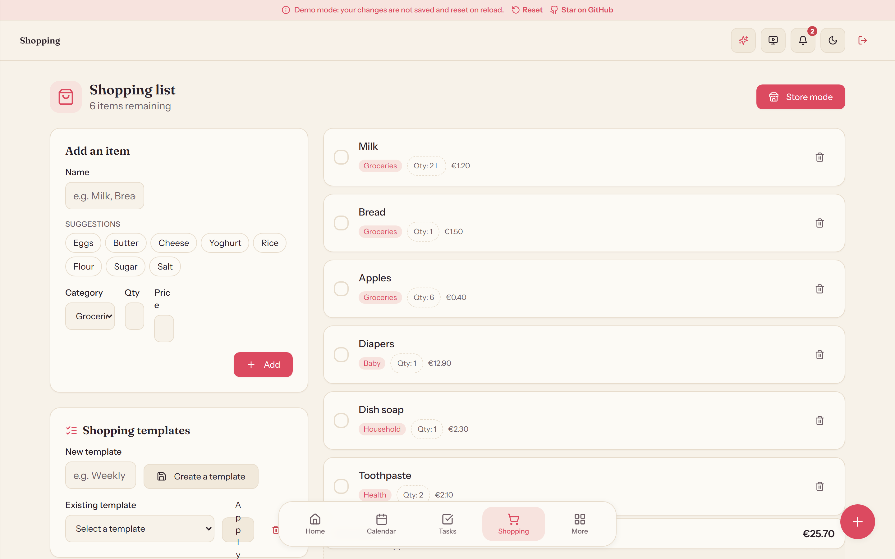
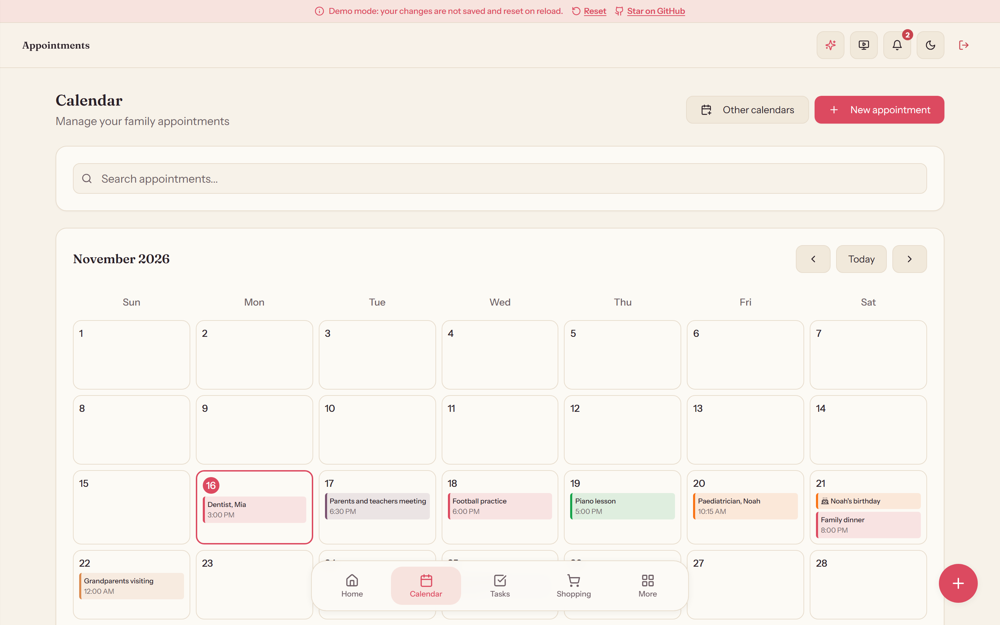
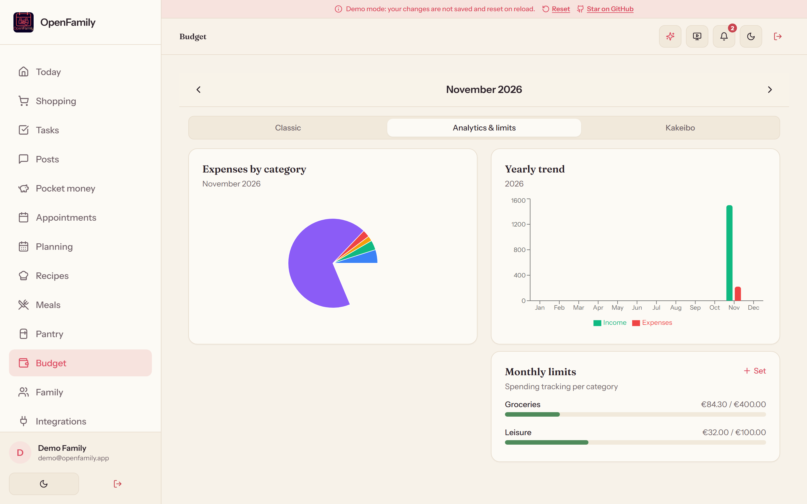
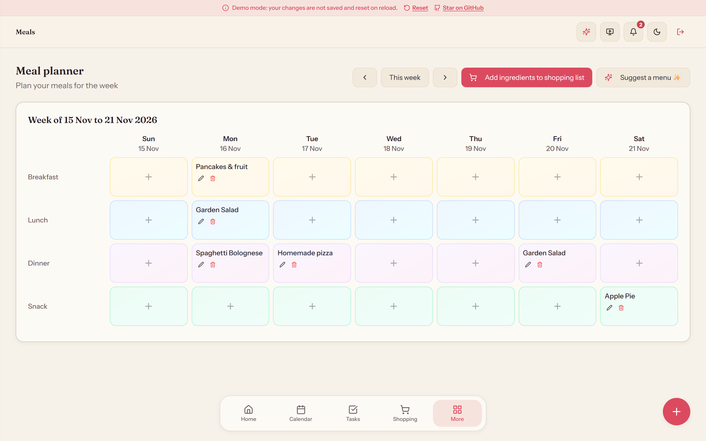
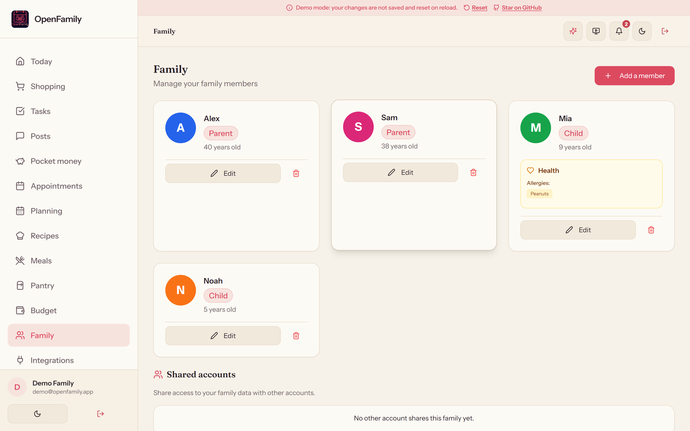
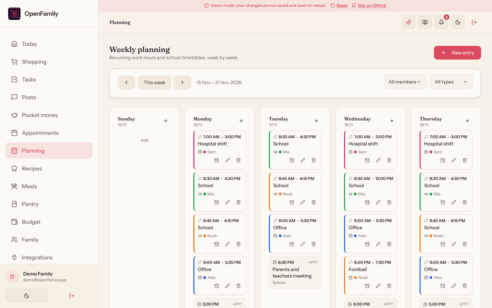

<div align="center">
  
  <h1>OpenFamily</h1>
  <p><strong>开源、自托管的家庭管理工具</strong><br>
  完全掌控你的家庭数据：在自己的服务器上运行。</p>

  🇬🇧 <a href="README.md">English</a> · 🇫🇷 <a href="README.fr.md">Français</a> · 🇨🇳 <strong>简体中文</strong>

  [](https://github.com/NexaFlowFrance/OpenFamily/releases/latest)
  [](https://github.com/NexaFlowFrance/OpenFamily/actions/workflows/ci.yml)
  [](https://openfamily.fr/demo/)
  [](https://github.com/NexaFlowFrance/OpenFamily/pkgs/container/openfamily)
  [](licence.md)
  [](https://github.com/NexaFlowFrance/OpenFamily)
</div>

---

<div align="center">

### 🎬 [在线体验](https://openfamily.fr/demo/)

*无需注册，完全在浏览器中运行，不会保存任何数据。*



</div>

OpenFamily 是 **Cozi 和 FamilyWall 等应用的自托管替代方案**：将购物清单、
任务、共享日历、每周计划、食谱、餐食计划、储藏和家庭预算整合在一起，
运行在你自己的服务器上。

## 🌟 与众不同之处

| | |
|---|---|
| 📱 **真正的 Android 应用** | 一个连接到你自己服务器的 [APK](https://github.com/NexaFlowFrance/OpenFamily/releases/latest/download/OpenFamily.apk)，可通过 Obtainium 保持更新。在其他手机上，Web 应用可以安装到主屏幕。 |
| 🔌 **向家里的其他系统开放** | 带个人令牌和 Webhook 的[文档化 API](API.md)，并集成 Home Assistant、[Gladys Assistant](https://github.com/NexaFlowFrance/gladys-openfamily)、Mealie、Tandoor、Grocy 和 Nextcloud。你的智能家居可以读取家庭当天的安排，并往购物清单里添加物品。 |
| 🖼️ **适合挂在墙上** | 为厨房平板准备的信息屏模式（带屏保），以及为电子墨水相框或电子阅读器设计的免登录页面。 |
| 🤖 **可以留在家里的助手** | 用自然语言添加内容，并根据你自己的食谱获得菜单建议；可通过 Ollama 使用本地模型，也可选择其他服务商。可选功能，未配置前保持关闭。 |
| 🐳 **一条命令即可运行** | [一个容器](#-docker一条命令)，无需任何配置。在 Windows 上还有完全不需要 Docker 的安装程序。 |
| ☁️ **或由我们托管** | [OpenFamily Cloud](https://openfamily.fr/#cloud) 在法国的服务器上运行同一个开源应用，适合不想自己维护服务器的家庭。你可以随时导出全部数据并迁移到自己的服务器。 |

## ✨ 功能

| | |
|---|---|
| 🛒 **购物清单** | 类别、价格、数量、模板以及**按商店区域整理的采购模式** |
| 🧊 **储藏** | 家里有什么，按存放位置（冰箱、冷冻室、橱柜）整理，含保质期和需要先吃的提醒，支持**条形码查询**（手动输入、摄像头扫描或扫码枪），并可一键加入购物清单 |
| ✅ **任务** | 重复任务、家庭成员分配、统计数据 |
| 📅 **日程** | 月视图日历、自动提醒、颜色标记、根据家庭成员出生日期自动显示的**生日**、**iCal 导出（.ics / webcal）** |
| 🗓️ **每周计划** | 按家庭成员管理工作时间和课程安排 |
| 🍳 **食谱** | 家庭食谱库、高级筛选、准备和烹饪时间 |
| 🍽️ **餐食计划** | 每周视图、PDF 导出、关联食谱 |
| 💰 **预算** | 每月跟踪、**图表**、**分类限额和警报**、定期扣款 |
| 👨‍👩‍👧‍👦 **家庭** | 成员档案、健康信息、紧急联系人 |
| 🔄 **实时同步** | 通过 WebSocket 在所有设备之间即时更新 |
| 🔔 **通知** | 日程提醒、任务警报（Web Push VAPID）和应用内通知 |
| 🖼️ **壁挂屏与电子墨水屏** | 适用于平板的全屏信息屏模式（带屏幕保护：照片或移动时钟，适合全天开启的屏幕），以及**显示屏链接**：无需登录即可在电子墨水相框（InkyPi）、电子书阅读器或任何无法登录的屏幕上显示家庭当日安排 |
| 🔌 **API、令牌与 Webhook** | 面向 Home Assistant、Gladys Assistant、n8n 或脚本的[API 文档](API.md)：只读或读写、可随时撤销的个人令牌，基于 WebSocket 的实时更新，以及在家庭数据变化时通知你的工具的 Webhook |
| 🤖 **AI 助手**（可选） | 用自然语言说出需求（“周四晚上吃千层面，并提醒 Mia 带游泳包”），内容会自动归入相应位置；还能根据你的食谱获得菜单建议。支持本地模型（Ollama）、任何兼容 OpenAI 的 API、Anthropic Claude 或 Google Gemini |
| 👥 **共享账号** | 通过链接邀请、**访问请求**、**所有权转让** |
| 🔑 **单点登录** | 使用您自己的 OpenID Connect 身份提供商登录（Authentik、Keycloak、Pocket ID……），可选仅限 SSO 的服务器，**在所有设备上退出登录** |
| 🛡️ **角色与权限** | **家长/孩子**账号，孩子只能以只读方式查看预算 |
| 🌍 **多语言** | 支持**英语/法语/德语/葡萄牙语/俄语/西班牙语/加泰罗尼亚语/简体中文**界面和自动检测 |
| 📴 **离线模式** | 无网络连接时仍可浏览缓存数据（PWA） |

## 📸 界面截图

| 购物（采购模式） | 日历 | 预算 |
|---|---|---|
|  |  |  |

| 餐食计划 | 家庭 | 每周计划 |
|---|---|---|
|  |  |  |

## 🔗 第三方集成

一键将 OpenFamily 连接到你的自托管生态系统，无需编辑配置文件。

| 应用 | 类型 | 同步内容 |
|---|---|---|
| **[Gladys Assistant](https://github.com/NexaFlowFrance/gladys-openfamily)** | 🏡 智能家居 | 在法国的开源智能家居助手 [Gladys](https://gladysassistant.com) 中显示家庭日历、购物清单和任务：仪表盘小组件、场景动作和触发器。从 Gladys 集成商店安装 |
| **Mealie** | 🍲 食谱 | 自动导入所有食谱（分页、API v1 和 v2） |
| **Tandoor** | 🌿 食谱 | 通过 Django REST API 导入 |
| **Home Assistant** | 🏠 购物 | 通过 WebSocket 同步购物清单（现代 `todo` 实体和旧版实体） |
| **Grocy** | 🥦 购物与库存 | 同步购物清单和库存 |
| **Nextcloud** | ☁️ 日历 | 通过自动发现和按 UID 去重导入 CalDAV |

> 🎬 感谢 **[Makernix](https://www.youtube.com/@Makernix)**：将 OpenFamily 与自托管家庭生态系统
> （Mealie、Grocy、Home Assistant、Nextcloud）连接起来的想法，来自与他的一次直接交流。

## 🚀 快速开始

### 🐳 Docker，一条命令

一个容器包含界面、API 和数据库。无需任何配置：密钥在首次启动时自动生成，并与数据保存在一起。

```bash
docker run -d --name openfamily --restart unless-stopped \
  -p 3000:3000 -v openfamily:/data \
  ghcr.io/nexaflowfrance/openfamily:latest
```

打开 http://localhost:3000，或在手机上打开 `http://<服务器地址>:3000`，然后创建账号。镜像支持 amd64 和 arm64（Raspberry Pi 4 和 5、大多数 NAS）。HTTPS、更新与备份见 **[服务器指南（英文）](INSTALLATION.md)**。

### 🪟 Windows 安装程序（.exe），最简单的方式

针对 Windows 用户，**NexaFlow** 提供一体化图形安装程序：内置 Node.js 和
PostgreSQL，**无需 Docker，也无需配置**。

<p>
  <a href="https://github.com/NexaFlowFrance/OpenFamily/releases/latest/download/OpenFamily-Setup.exe">
    
  </a>
</p>

运行 `OpenFamily-Setup.exe`，点击 **Start**，然后通过 http://localhost:3000 打开应用。
窗口中还会显示本地网络地址，便于使用同一 Wi-Fi 下的手机访问；**设置**页面中还会说明
如何配置 Tailscale 以实现安全的远程访问。

### 📱 Android 应用（APK）

OpenFamily 还提供原生 **Android 应用**，它是一个连接到**你自己**服务器的轻量客户端
（首次启动时输入服务器地址，与 Nextcloud 或 Home Assistant 应用类似）。它本身不托管任何服务。

<p>
  <a href="https://github.com/NexaFlowFrance/OpenFamily/releases/latest/download/OpenFamily.apk">
    
  </a>
</p>

安装 APK，在系统提示时允许安装未知来源应用，然后打开应用并输入服务器 URL
（例如 `http://192.168.1.10:3000`，或你的 HTTPS / Tailscale 地址）。

> 🔄 **自动保持最新版本：**将本仓库添加到
> **[Obtainium](https://github.com/ImranR98/Obtainium)**，即可直接通过 GitHub Releases 接收应用更新，无需应用商店。

### 🧩 Docker Compose，各部分独立容器

同一个应用拆成三个容器（PostgreSQL、API、Web 服务器），适合希望各部分分开运行或从源码构建的服务器。请按照分步 **[服务器指南（英文）](INSTALLATION.md)** 操作：需要设置的密钥、通过域名或 Tailscale 启用 HTTPS、更新与备份。

```bash
cp .env.example .env   # 编辑配置
docker-compose up -d --build
```

- 前端：http://localhost:3000
- 后端 API：http://localhost:3001

运行端到端验证：

```bash
npm run smoke:api
```

**想直接使用现成镜像？** 每个版本都会发布 amd64 和 arm64 镜像。在 `docker-compose.yml` 旁边创建 `docker-compose.override.yml`：

```yaml
services:
  server:
    image: ghcr.io/nexaflowfrance/openfamily-server:2.2.0
  client:
    image: ghcr.io/nexaflowfrance/openfamily-client:2.2.0
```

然后运行 `docker compose pull server client && docker compose up -d`（不要加 `--build`）。镜像名必须带 `-server` / `-client` 后缀。`REGISTRATION_ENABLED` 等设置由服务器在启动时读取，已发布的镜像无需重新构建。

### 🛠️ 手动安装

```bash
npm run install:all
psql -U postgres -c "CREATE DATABASE openfamily;"
cp .env.example .env
npm run dev
```

- 前端：http://localhost:5173 · 后端：http://localhost:3001

## 🆚 为什么选择 OpenFamily？

| | OpenFamily | Cozi / FamilyWall |
|---|---|---|
| 数据存储在你自己的服务器上 | ✅ | ❌ |
| 开源（AGPL-3.0） | ✅ | ❌ |
| 无广告、无跟踪 | ✅ | ❌ |
| 自托管集成（Gladys Assistant、Home Assistant、Mealie、Grocy 等） | ✅ | ❌ |
| 带令牌和 Webhook 的文档化 API | ✅ | ❌ |
| 可在本地模型上运行的 AI 助手 | ✅ | ❌ |
| 离线工作（PWA） | ✅ | ⚠️ |

## 🧰 技术栈

**前端**：React 19 · TypeScript · Vite 7 · TailwindCSS · Radix UI · i18next · PWA（Service Worker、Web Push、离线模式）  
**后端**：Node.js 26 · Express · PostgreSQL 16（自动迁移）· WebSocket · Web Push（VAPID）· JWT + bcrypt 12 · helmet · 限流  
**DevOps**：一体化镜像，或 Docker Compose（postgres、server、client/nginx）· GitHub Actions（CI、发布 Docker 镜像到 ghcr.io、GitHub Pages 演示）

## 🔐 安全

JWT 身份验证（有效期 7 天，自动刷新）· 使用 **bcrypt（cost 12）** 哈希密码 · 通过 **helmet** 设置安全 HTTP 响应头 ·
身份验证接口限流 · 严格且可配置的 CORS · 服务端输入验证 · 结构化日志（不包含敏感数据）。

## 🗺️ 路线图

计划功能和设计决策请参阅 [ROADMAP.md](ROADMAP.md)。

## 💛 支持项目

OpenFamily 是免费、开源（AGPL-3.0）且自托管的：没有广告、没有追踪、没有付费版本。
它由个人业余时间开发和维护。如果它对你的家庭有帮助，欢迎支持它的开发：

<p>
  <a href="https://github.com/sponsors/NexaFlowFrance">
    
  </a>
  <a href="https://ko-fi.com/nexaflowfrance">
    
  </a>
</p>

给仓库点个 Star 同样有帮助：其他家庭正是这样发现这个项目的。

## 🤝 参与贡献

OpenFamily 的许多部分来自它的使用者：语言、集成，以及后来变成功能的想法。

- **有想法或疑问？** 发起一个[讨论](https://github.com/NexaFlowFrance/OpenFamily/discussions)。
- **发现问题？** 创建一个 [Issue](https://github.com/NexaFlowFrance/OpenFamily/issues/new/choose)。
- **缺少你的语言，或翻译不够好？** 参见 [TRANSLATING.md](TRANSLATING.md)（英文）：翻译可以逐条提交，未翻译的部分会以英文显示。
- **想写代码？** [CONTRIBUTING.md](CONTRIBUTING.md)（英文）说明了如何运行项目以及 Pull Request 的要求。

## 📄 许可证

GNU Affero General Public License v3.0（AGPL-3.0-only），详见 [licence.md](licence.md)。

## 🙏 致谢

由 [NexaFlow France](https://nexaflow.fr) 开发和维护。
