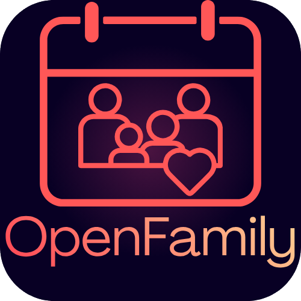

# OpenFamily

OpenFamily keeps the whole household organized from your own server. One app for the family, in eight languages, on any device.

## Features

- **Shared calendar**: appointments, school events, activities, with per-member colors, reminders and an iCal feed.
- **Tasks and chores**: recurring chores with a points and rewards system for kids (pocket-money ledger, savings goals).
- **Shopping lists**: collaborative lists with live updates on every device, and an aisle-by-aisle store mode.
- **Meal planning and recipes**: weekly meal plan, family recipe book, recipe import from the web.
- **Budget**: track family expenses, with limits per category.
- **Kiosk mode**: a dashboard for a wall-mounted tablet in the kitchen or hallway, and login-free pages for e-paper frames.
- **AI assistant** *(optional)*: a natural-language helper for planning and lists, with the provider of your choice or a local model.
- **Android app**, and a documented API with personal tokens and webhooks.
- **Integrations**: Home Assistant, Gladys Assistant, Mealie, Tandoor, Grocy, Nextcloud (CalDAV).

## First start

1. Open the app and create the first account: it becomes the owner of a new family.
2. Invite the rest of the family from the Family page.
3. Turn off new registrations in the app settings once your account exists. People you invite can still join.

Everything to back up is in the app's data folder: the database and the secrets generated on the first start.

## Links

- Source: <https://github.com/NexaFlowFrance/OpenFamily>
- Website and demo: <https://openfamily.fr/>
